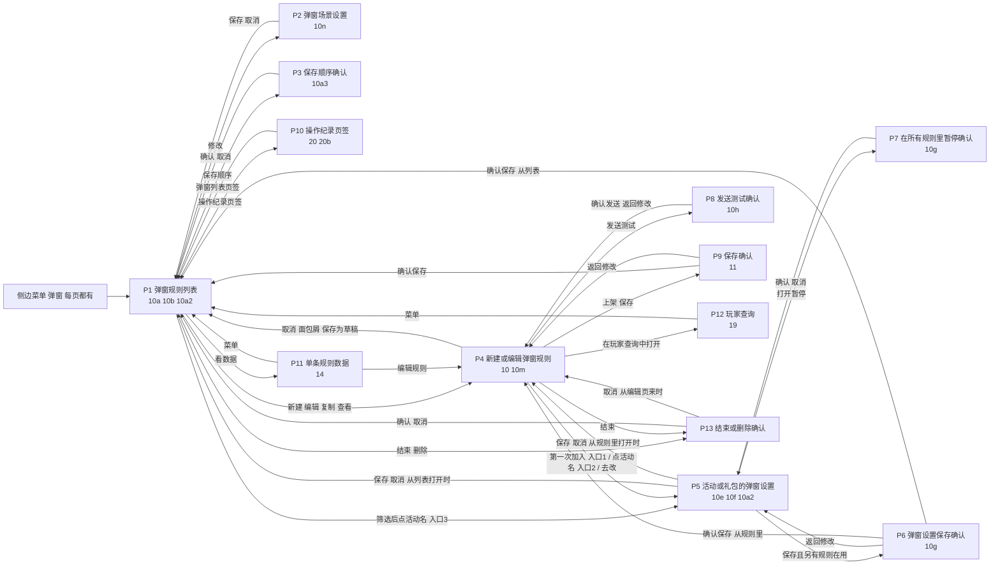

# 弹窗后台面包板（页面关系）

任务：`~/claude/_底座/任务/弹窗标签推送系统/2026-10-30_弹窗按六步重排.md`　里程碑 2 第一波　10/30 执行子代理草稿，未交付。
依据：功能框架弹窗段（`评审版_定稿改_1027/推送系统后台集成需求/功能框架_脑图.md` 第 147–355 行，四个功能：弹窗场景设置、弹窗规则列表、新建弹窗规则、活动或礼包的弹窗设置）；`里程碑1_底稿/` 卡 A1–A4、B1–B5、C。待拍板按推荐画，标「可推翻」，随它变的控件列在第 4 节。
写法：每页一节，表里一行一个可点控件：这页能点什么｜点了去哪｜回指（卡·字段）。卡里是字段表的写字段名；是按钮、只在规则或异常里写到的，写「规则第 N 条」「异常」。控件编号和 `控件回指表.md` 一致。「只读」行列这页显示、不能点的项。
原型页名：沿用编号；改了名的在括号里写旧名。新页 2 张：10g、10h。

## 1. 页面清单

| 页 | 页名 | 是什么 | 原型页 |
|---|---|---|---|
| G | 侧边菜单 | 每页都有 | 全部 |
| P1 | 弹窗规则列表 | 主页面，四个场景页签 | 10a（进大厅）、10b_破产时页签（旧 10b_弹窗模拟玩家）、10a2_按活动筛选后改弹窗设置（旧 10a2_名称悬停） |
| P2 | 弹窗场景设置 | 对话框 | 10n |
| P3 | 保存顺序确认 | 对话框 | 10a3_保存顺序确认（旧 10a3_调整优先级） |
| P4 | 新建／编辑弹窗规则 | 整页；含本规则另设、发送测试、按玩家预览 | 10（主图）、10m（按玩家预览展开）；10e、10f、11 以它作底图 |
| P5 | 活动或礼包的弹窗设置 | 侧边框，三个入口打开同一份 | 10e（第一次加入）、10f（带出、另有几条在用）、10a2（从列表打开） |
| P6 | 弹窗设置保存确认 | 对话框 | 10g_弹窗设置改动确认（新）上图 |
| P7 | 在所有规则里暂停确认 | 对话框 | 10g 下图 |
| P8 | 发送测试确认 | 对话框 | 10h_发送测试确认（新） |
| P9 | 保存确认 | 对话框 | 11 |
| P10 | 操作纪录页签 | 弹窗页第二个页签 | 20_操作纪录、20b（邻接页，预筛「弹窗」） |
| P11 | 单条规则数据 | 数据模块页 | 14（邻接页，只改叫法） |
| P12 | 玩家查询 | 查询模块页 | 19（邻接页，只改叫法） |
| P13 | 结束／删除确认 | 通用确认框 | 不单画，10a 图注写确认文字 |

## 2. 每页能点什么、点了去哪

### G 侧边菜单（全部页）
| 编号 | 控件 | 点了去哪 | 回指 |
|---|---|---|---|
| G-01 | 「游戏内推送 › 弹窗」 | P1，默认进大厅页签 | A2·按场景分页签（默认打开进大厅） |

### P1 弹窗规则列表（10a、10b、10a2）
| 编号 | 控件 | 点了去哪 | 回指 |
|---|---|---|---|
| P1-01 | 场景页签：进大厅／破产时／买了指定礼包后／押注达到指定金额 | P1，换到该场景（10b 画破产时） | A2·按场景分页签 |
| P1-02 | 页签「操作纪录」 | P10 | A3·入口 |
| P1-03 | 页签顶部场景设置一行的「修改」 | P2 | A1·场景（跟着所在页签）；A1 第 2 栏（点「修改」在对话框里改） |
| P1-04 | 「＋ 新建弹窗规则」 | P4（新建，场景默认当前页签） | B1·场景（必填，默认＝点新建时所在页签） |
| P1-05 | 搜索框（名称、编号或发送对象群组名） | P1，只列命中的 | A2·搜索 |
| P1-06 | 「显示已结束的」是／否 | P1 | A2·显示已结束的 |
| P1-07 | 「按活动或礼包筛选」下拉 | P1 筛选态（10a2），活动名变成可点 | A2·按活动或礼包筛选 |
| P1-08 | 筛选后的活动或礼包名 | P5（从列表打开，写「共 N 条规则在用」） | C·入口③（不进规则时）；A2 规则第 6 条 |
| P1-09 | 行首拖动手柄（优先级；有搜索或筛选时不可拖） | P1 拖动态，出现「保存顺序」 | A2·优先级 |
| P1-10 | 「保存顺序」 | P3 | A2·优先级；A2 规则第 3 条 |
| P1-11 | 点行：展开／收起 | P1，该行展开（有哪些弹窗、固定或轮换池、顺序、轮换池每次弹几个、这次不会弹的标注） | A2·展开·有哪些弹窗（默认收起） |
| P1-12 | 行操作「编辑」 | P4（编辑这条） | A2·每行·操作 |
| P1-13 | 行操作「复制」 | P4（草稿副本，名称加「（副本）」，可改场景） | A2·复制规则 |
| P1-14 | 行操作「暂停」 | P1，状态变已暂停 | A2·每行·操作 |
| P1-15 | 行操作「恢复」 | P1，回上架中或未开始 | A2·每行·操作 |
| P1-16 | 行操作「结束」 | P13（确认后 P1，已结束） | A2·每行·操作；A2 异常（点结束：确认框） |
| P1-17 | 行操作「看数据」 | P11 | A2·每行·操作 |
| P1-18 | 行操作「查看」（仅已结束） | P4 只读 | A2·每行·操作 |
| P1-19 | 行操作「删除」（仅草稿） | P13（确认后 P1，这行消失） | A2·每行·操作；A2 异常（删除草稿：确认框） |
| P1-20 | 行操作「操作纪录」 | P10（搜索框带出这条规则的名称） | A2·每行·操作；A3·筛选（从规则列表的操作里点进来时，带出这条规则的名称） |

只读：场景设置一行（A1 五项）；每行名称、编号、发送对象和人数、弹窗（共 N 个，轮换池 M 个，每次最多弹 K 个）、状态（A2 每行·各项）；展开里的四项和「这次不会弹的标注」（A2 展开·各项）。
去掉的旧控件：列表上的「按玩家预览」（移到 P4，B4）、〔旧〕「调整优先级」（改成直接拖＋保存顺序，A2）、状态计数筛选（改成「显示已结束的」，A2）。

### P2 弹窗场景设置（10n）
| 编号 | 控件 | 点了去哪 | 回指 |
|---|---|---|---|
| P2-01 | 多条规则都符合时：只用优先级最高的一条／轮流，每次换下一条 | P2 | A1·多条规则都符合时 |
| P2-02 | 每人每天最多弹几个（仅进大厅页签出现；留空＝不限） | P2 | A1·每人每天最多弹几个（仅进大厅） |
| P2-03 | 弹出间隔（分钟；留空＝不设） | P2 | A1·弹出间隔 |
| P2-04 | 不受弹出间隔限制：「＋ 加入活动或礼包」（从本场景规则里用到的多选） | P2 | A1·不受弹出间隔限制的活动或礼包 |
| P2-05 | 已选项旁「×」 | P2，移出例外 | A1·不受弹出间隔限制的活动或礼包 |
| P2-06 | 「保存」 | P1，顶部一行更新，记一条操作纪录 | A1 规则第 1 条 |
| P2-07 | 「取消」「×」 | P1，不改 | A1 第 2 栏（对话框里改、保存） |

只读：提示「只影响之后的弹出」并列出这个场景在用的规则（待拍板第 9 条推荐）。

### P3 保存顺序确认（10a3）
| 编号 | 控件 | 点了去哪 | 回指 |
|---|---|---|---|
| P3-01 | 「确认」 | P1，新顺序生效，记一条操作纪录 | A2·优先级；A2 规则第 3 条 |
| P3-02 | 「取消」 | P1，回到拖动前的顺序 | A2 规则第 3 条 |

只读：改前、改后的顺序；「只影响之后的弹出」。

### P4 新建／编辑弹窗规则（10、10m）
| 编号 | 控件 | 点了去哪 | 回指 |
|---|---|---|---|
| P4-01 | 面包屑「弹窗」 | P1，回原页签 | A2·按场景分页签 |
| P4-02 | 顶部「复制」 | P4，草稿副本 | A2·复制规则 |
| P4-03 | 顶部「暂停」／「恢复」（按状态给） | P4，状态变 | A2·每行·操作 |
| P4-04 | 顶部「结束」（〔旧〕「下架」） | P13（确认后 P1） | A2·每行·操作；A2 异常 |
| P4-05 | 场景单选（四个；草稿可改，上架后只读） | P4 | B1·场景（必填） |
| P4-06 | 礼包多选（仅「买了指定礼包后」出现） | P4 | B1·场景参数：礼包或金额 |
| P4-07 | 金额输入（仅「押注达到指定金额」出现） | P4 | B1·场景参数：礼包或金额 |
| P4-08 | 名称（一个输入框，默认「场景·发送对象群组名」） | P4 | B1·名称（必填） |
| P4-09 | 发送对象单选：全部玩家／群组／上传名单 | P4 | B1·发送对象（必填） |
| P4-10 | 群组多选下拉（含按随机分组号建的实验组、对照组群组） | P4 | B1·发送对象；B1·实验组与对照组 |
| P4-11 | 多个群组时：满足任一个／同时满足全部（选 2 个以上才出现） | P4 | B1·多个群组时 |
| P4-12 | 「上传名单」 | 选文件，回 P4 显示名单人数 | B1·发送对象（必填） |
| P4-13 | 排除群组多选下拉（默认空） | P4 | B1·排除群组（选填） |
| P4-14 | 生效期间：长期／指定起止 | P4 | B1·生效期间（必填） |
| P4-15 | 起止时间选择（仅指定起止） | P4 | B1·生效期间（必填） |
| P4-16 | 每次最多弹几个（默认进大厅 3、其他 1） | P4 | B2·每次最多弹几个（必填） |
| P4-17 | 「＋ 加入活动或礼包」 | 选择框（可选：未结束的活动和礼包；搜名称或编号、可多选） | B2·弹哪些活动或礼包 |
| P4-18 | 选择框里选中一个 | 第一次进弹窗的：P5（10e，入口①）；已有弹窗设置的：留在 P4，这一行写「沿用活动设置」（入口②） | C·入口①、入口② |
| P4-19 | 固定的先后：拖动手柄（新加入的排最后） | P4 | B2·先后（固定的弹出顺序） |
| P4-20 | 每行「是否进轮换池」是／否（默认否） | P4，这一行移到轮换池段或固定段 | B2·是否进轮换池（每个活动或礼包） |
| P4-21 | 轮换池内顺序：拖动手柄（默认按进池先后） | P4 | B2·轮换池内顺序 |
| P4-22 | 轮换池每次弹几个（仅有进池时出现，默认 1） | P4 | B2·轮换池每次弹几个 |
| P4-23 | 每行活动或礼包名 | P5（10f，带出、另有几条在用） | C·入口②；C 规则第 2 条（任何入口改的都是同一份） |
| P4-24 | 每行「本规则另设」展开／收起 | P4，展开四项 | B3 第 2 栏（在这一行点「本规则另设」） |
| P4-25 | 另设·点击后是否跳转：沿用／是／否 | P4 | B3·点击后是否跳转（本规则） |
| P4-26 | 另设·弹出时机（仅进大厅） | P4 | B3·弹出时机（本规则） |
| P4-27 | 另设·每人每天几次 | P4 | B3·每人每天几次（本规则） |
| P4-28 | 另设·每人两次至少隔多久（数字＋分钟或小时） | P4 | B3·每人两次至少隔多久（本规则） |
| P4-29 | 另设过的项旁「恢复沿用」 | P4，这项改回活动或礼包当前的值 | B3·恢复沿用 |
| P4-30 | 宣传图、跳转页面（只读）旁「去改」 | P5 | B3·宣传图、跳转页面（只读） |
| P4-31 | 每行「移除」 | P4 | B2·弹哪些活动或礼包；B5 规则第 4 条（加入或删掉的活动或礼包） |
| P4-32 | 发送测试·测试群组下拉 | P4 | B4·测试对象（发送测试） |
| P4-33 | 发送测试·会员编号（可填多个；默认上次用过的） | P4 | B4·测试对象（发送测试） |
| P4-34 | 发送测试·测哪些活动或礼包（逐个勾，默认全选） | P4 | B4·测哪些活动或礼包（发送测试） |
| P4-35 | 「发送测试」 | P8 | B4 规则第 1、7 条 |
| P4-36 | 按玩家预览·会员编号 | P4 | B4·会员编号（按玩家预览） |
| P4-37 | 「预览」 | P4，下方出结果四样（10m） | B4 规则第 8、10 条 |
| P4-38 | 预览结果里「在玩家查询中打开」 | P12 | B4·预览哪个场景、按哪一版算（所有场景到玩家查询看） |
| P4-39 | 「取消」 | P1，不保存 | A2·按场景分页签（回原页签） |
| P4-40 | 「保存为草稿」（新建、草稿时） | P1，草稿，不弹确认 | B5 规则第 1 条 |
| P4-41 | 「上架」（新建、草稿时） | P9 | B5 规则第 1 条 |
| P4-42 | 「保存」（上架中、已暂停时；没有改动时不可点） | P9 | B5 规则第 1 条 |

只读：固定不弹（黑名单、停权、自我限制、注销处理中，机器人和测试账号；上传名单时除外）（B1 规则、功能清单第 95 行）；预计人数：符合发送对象、扣除排除后（B1·预计人数）；本规则另设里没动过的项灰显「沿用」（B3 第 4 栏）；发送测试·每次最多 50 人（B4·每次最多）；预览场景、按哪一版算（B4·预览哪个场景、按哪一版算）；预览结果四样（B4 规则第 10 条）。
去掉的旧控件：〔旧〕「显示方式」列（改「点击后是否跳转」，在 P5 和本规则另设里）；名称三语三个框（待拍板第 10 条推荐）。

### P5 活动或礼包的弹窗设置（侧边框：10e、10f、10a2）
入口：P4-18（规则里第一次加入时，入口①）、P4-23（规则里点活动名，入口②）、P4-30（另设里「去改」）、P1-08（规则列表按活动或礼包筛选后点活动名，入口③，不进规则时改和暂停走这里）。
| 编号 | 控件 | 点了去哪 | 回指 |
|---|---|---|---|
| P5-01 | 宣传图：可上传替换（按钮「上传替换」；默认用活动或礼包自带的） | P5 | C·宣传图 |
| P5-02 | 「恢复用自带的」（上传过才出现） | P5 | C·宣传图 |
| P5-03 | 点击后是否跳转：是／否（默认是） | P5；选否时跳转页面收起 | C·点击后是否跳转 |
| P5-04 | 跳转页面：本活动或礼包页面／其他页面（选其他时再选具体页） | P5 | C·跳转页面 |
| P5-05 | 弹出时机（仅进大厅；单选：每次进大厅，含从游戏返回／只在从游戏返回时／当天首次登录／活动开始后第一次进大厅；默认活动选第一项、礼包选第二项） | P5 | C·弹出时机（仅进大厅） |
| P5-06 | 每人每天几次（默认活动 1、礼包 2） | P5 | C·每人每天几次 |
| P5-07 | 每人两次至少隔多久（填数字，单位：分钟、小时；留空＝不限） | P5 | C·每人两次至少隔多久 |
| P5-08 | 「在所有规则里暂停」开关 | 打开：P7；关闭：P5，直接恢复弹 | C·在所有规则里暂停 |
| P5-09 | 「另有 N 条规则在用」展开／收起 | P5，列规则名、场景、状态、另设的项 | C·另有几条规则在用 |
| P5-10 | 「保存」 | 另有规则在用：P6；没有：回打开它的页（P4 或 P1 筛选态） | C 规则第 2 条 |
| P5-11 | 「取消」「×」 | 回打开它的页（P4 或 P1 筛选态） | C·入口①②③（打开同一个侧边框，关了回原处） |

只读：对应的活动或礼包（名称、活动还是礼包、起止时间）（C·对应的活动或礼包）；计算范围「同一场景各规则合计」（C 规则第 7 条）；暂停的范围「只停弹窗」（C·在所有规则里暂停）。
去掉的旧控件：10f 的「在规则列表里按 X 筛选 ›」链接（卡里没有；跨场景看在几条规则里用 P5-09）；〔旧〕「显示方式」。

### P6 弹窗设置保存确认（10g 上图）
| 编号 | 控件 | 点了去哪 | 回指 |
|---|---|---|---|
| P6-01 | 「确认保存」 | 回打开侧边框的页（P4 或 P1 筛选态），N 条规则一起变 | C 规则第 2 条 |
| P6-02 | 「返回修改」 | P5 | C 规则第 2 条 |

只读：在用的规则逐条列；对改了的项另设过的规则写「这条规则另设过，不跟着变」（C 规则第 2 条、异常）。

### P7 在所有规则里暂停确认（10g 下图）
| 编号 | 控件 | 点了去哪 | 回指 |
|---|---|---|---|
| P7-01 | 「确认暂停」 | P5，开关为开 | C·在所有规则里暂停（打开前确认） |
| P7-02 | 「取消」 | P5，开关仍关 | C·在所有规则里暂停（打开前确认） |

只读：在用的规则逐条列；暂停后没有可弹的规则点名（C 异常）；「只停弹窗，活动照常」。

### P8 发送测试确认（10h）
| 编号 | 控件 | 点了去哪 | 回指 |
|---|---|---|---|
| P8-01 | 「确认发送」 | P4，发送测试区列每个测试账号状态：等待弹出／已弹（时间）（10h 第二张图） | B4 规则第 6、7 条 |
| P8-02 | 「返回修改」 | P4 | B4 规则第 7 条 |

只读：人数、会员编号逐个列（超过 50 人不能发）；测哪些活动或礼包（B4 规则第 7 条）。

### P9 保存确认（11）
| 编号 | 控件 | 点了去哪 | 回指 |
|---|---|---|---|
| P9-01 | 「确认保存」 | P1，状态按 A2 规则第 7 条变 | B5 规则第 3 条 |
| P9-02 | 「返回修改」 | P4，改动还在 | B5 规则第 3 条 |

只读（有内容才出）：每行改了什么、改前、改后；发送对象人数变化；本规则排第几、弹不到本规则的人数（B5·排第几、谁弹不到）；哪些活动或礼包弹不到（B5·规则里弹不弹得到，含待拍板第 1 条推荐的「轮换池有能弹的时候，固定的一个也弹不到」）；轮流时会错过的弹出时机；轮流时其余规则的排除提醒；什么时候生效：下一次进入场景起（B5 各字段）。

### P10 操作纪录页签（20、20b，预筛「弹窗」）
| 编号 | 控件 | 点了去哪 | 回指 |
|---|---|---|---|
| P10-01 | 页签「弹窗列表」 | P1 | A2·按场景分页签 |
| P10-02 | 搜索名称或编号 | P10 | A3·筛选 |
| P10-03 | 时间范围（默认近 7 天） | P10 | A3·筛选 |
| P10-04 | 每行「▸」展开 | P10，逐项改前、改后（20b） | A3·改前、改后 |

只读：记录范围四类（场景设置、弹窗规则、活动或礼包的弹窗设置、系统改动）；时间、操作人；改的是哪个（A3 各字段）。
未定：20 是全后台共用页，自带操作人、操作两个筛选；卡 A3 写弹窗这里只留搜索和时间范围。面包板暂按沿用 20、不改它，是否收成两项交第二级定。

### P11 单条规则数据（14，只改叫法）
| 编号 | 控件 | 点了去哪 | 回指 |
|---|---|---|---|
| P11-01 | 「编辑规则」 | P4（编辑这条） | A2·每行·操作（看数据的回程） |

回 P1 用 G-01。页内图表、时间范围归数据模块，不在本面包板。

### P12 玩家查询（19，只改叫法）
从 P4-38 进；回 P1 用 G-01。页内控件归查询模块，不在本面包板。

### P13 结束／删除确认（不单画，10a 图注写文字）
| 编号 | 控件 | 点了去哪 | 回指 |
|---|---|---|---|
| P13-01 | 「确认」 | P1（结束的标已结束；删除的这行消失） | A2 异常（结束后不能恢复，删除后找不回） |
| P13-02 | 「取消」 | 回原页（P1 或 P4） | A2 异常 |

## 3. 页面关系图

「不进规则时从哪改活动或礼包的弹窗设置」：P1 按活动或礼包筛选（P1-07）→ 点活动名（P1-08）→ P5，在里面改和暂停（卡 C 入口③；不加新页，已替你定，可推翻）。

## 4. 随待拍板变的控件

编号用 `里程碑1_底稿/待拍板汇总.md` 的「第 N 条」。现在都按推荐画，可推翻；Dk 答复后只改这些处。〔显示〕是只读项，不是可点控件。

| 控件 | 第几条 | 选备选时怎么变 |
|---|---|---|
| P4-16 每次最多弹几个 | 第 1 条 | 改名「固定的每次弹几个」，和 P4-22 相加才是一次最多弹几个；默认值按新口径重定 |
| P4-22 轮换池每次弹几个 | 第 1 条 | 上限不再受「每次最多弹几个」管，改成 1 到池内个数；轮换池这次没得弹就少弹，不让给固定的 |
| 〔显示〕P9 规则里弹不弹得到 | 第 1 条 | 去掉「轮换池有能弹的时候，固定的一个也弹不到」，按卡 B5 规则第 7 条的条件句重写 |
| 〔显示〕P1 每行·弹窗 | 第 1 条 | 「每次最多弹 K 个」改写成「固定每次弹 K 个＋轮换池每次弹 M 个」 |
| 〔显示〕P4 预览结果「没弹的原因」 | 第 1 条 | 「固定的已占满」「已达每次最多弹几个」两种原因按备选口径改 |
| P2-02 每人每天最多弹几个 | 第 2 条 | 默认改成留空（不限） |
| P2-03 弹出间隔 | 第 3 条 | 默认改成留空（不设） |
| P5-05 弹出时机、P4-26 另设·弹出时机 | 第 4 条 | 改回多选，选项加回「当天第 2 次登录起」「当天第 N 次登录」，共 6 项 |
| 〔显示〕P9 轮流时会错过的弹出时机 | 第 4 条 | 多两种时机要提示 |
| P4-13 排除群组 | 第 5 条 | 默认带「VIP 名单」 |
| P5 每人每天几次下方 | 第 6 条 | 加一个「每人总共几次」输入框（P4 本规则另设要不要跟着加，到时再定） |
| P5-03 点击后是否跳转 | 第 7 条 | 改成必选、无默认 |
| P5-05 弹出时机的默认 | 第 7 条 | 活动、礼包都默认「每次进大厅，含从游戏返回」 |
| P4 发送对象下方、P1 每行 | 第 8 条 | 规则编辑页加「标签状态」开关，列表加一列 |
| 〔显示〕P2 改动提示 | 第 9 条 | 加「下一次进入会变的人数」「今天预计多拦或少拦多少人」 |
| P4-08 名称 | 第 10 条 | 改成三个输入框：繁中、越南文、英文 |

## 5. 旧原型页逐页去留

18 张：留并改 10 张、只改叫法 3 张、并入 1 张、删 4 张；另加新页 2 张（10g、10h）。邻接页 20、20b 不在这 18 张里，沿用不改。

| 旧页 | 去留 | 新页名 | 理由 |
|---|---|---|---|
| 10_规则编辑 | 留并改 | 10_规则编辑 | P4 主图：去掉〔旧〕「显示方式」列和三语名称，加是否进轮换池、轮换池段、轮换池每次弹几个、本规则另设四项和恢复沿用、发送测试三项，保存按钮按状态分，〔旧〕「下架」改「结束」 |
| 10a_弹窗列表 | 留并改 | 10a_弹窗列表 | P1 进大厅：去掉列表上的「按玩家预览」、〔旧〕「调整优先级」和状态计数，加「显示已结束的」、每行弹窗列、一行展开、操作纪录页签；行里不再默认排除 VIP 名单（待拍板第 5 条） |
| 10a2_名称悬停 | 留并改，改名 | 10a2_按活动筛选后改弹窗设置 | 画卡 C 入口③：列表按活动或礼包筛选后点活动名，打开侧边框改和暂停；旧的悬停看规则内容由「每条展开」取代 |
| 10a3_调整优先级 | 留并改，改名 | 10a3_保存顺序确认 | 〔旧〕「调整优先级」模式改成直接拖，点「保存顺序」弹改前改后确认（卡 A2 规则第 3 条） |
| 10b_弹窗模拟玩家 | 留并改，改名 | 10b_破产时页签 | 页面本来就是破产时页签：画只用优先级最高的一条、不受弹出间隔限制、没有每人每天上限、实验组和对照组两条规则 |
| 10c_弹窗库 | 删 | — | 推荐 C 已定不单独建弹窗内容页，弹窗设置在侧边框里 |
| 10c3_从规则点热门资讯 | 删 | — | 是弹窗内容库里展开引用的图；改由 10a2 筛选和侧边框「另有几条规则在用」看 |
| 10d_弹窗拖动未保存 | 并入 11 | — | 拖动后未保存就是 11 保存确认的前一步；旧页还用〔旧〕「弹窗位置」「弹窗内容」「冷却」 |
| 10e_弹窗设置首次配置 | 留并改 | 10e_弹窗设置首次配置 | 卡 C 入口①：〔旧〕「显示方式」改「点击后是否跳转」（默认是），弹出时机按活动或礼包给默认，每人每天几次活动 1、礼包 2，「不设」改留空，加「恢复用自带的」 |
| 10f_弹窗设置带出与在用 | 留并改 | 10f_弹窗设置带出与在用 | 卡 C 入口②：同 10e 的改法；去掉卡里没有的「在规则列表里按 X 筛选」链接 |
| 10j_取用方式 | 删 | — | 〔旧〕「取用方式、轮换位」已拆成场景设置的「多条规则都符合时」和规则里的「轮换池」，两处都在新页里画 |
| 10k_轮换位示意 | 删 | — | 〔旧〕「命中方式对比」示意图；两种选法的说明写在 10n 选项下和源 html 业务规则里，原型不放示意图 |
| 10m_按玩家预览 | 留并改 | 10m_按玩家预览 | 从列表上看所有场景，改成规则编辑页里只看本规则场景、按编辑中这一版算，结果四样；所有场景到玩家查询看 |
| 10n_场景设置 | 留并改 | 10n_场景设置 | 去掉「2,960 人会变」推算（待拍板第 9 条），〔旧〕「填 0 为不设」改留空，提示只影响之后的弹出并列出在用规则 |
| 11_保存确认 | 留并改 | 11_保存确认 | 底图去掉〔旧〕「显示方式」；确认框加是否进轮换池、本规则另设的改动，排第几、谁弹不到，轮换池提示，轮流错过的弹出时机，什么时候生效 |
| 13_游戏内数据 | 只改叫法 | 13_游戏内数据 | 数据模块页，从数据菜单进出，不在本面包板 |
| 14_单条规则数据 | 只改叫法 | 14_单条规则数据 | P11：列表「看数据」进，「编辑规则」回 P4 |
| 19_玩家查询 | 只改叫法 | 19_玩家查询 | P12：从 10m「在玩家查询中打开」进 |
| （无） | 新页 | 10g_弹窗设置改动确认 | 卡 C 规则第 2 条保存确认、「在所有规则里暂停」打开前确认，旧页没有；一页两张图 |
| （无） | 新页 | 10h_发送测试确认 | 卡 B4 规则第 7 条发送前确认人数和会员编号、规则第 6 条发送后状态，旧页没有 |

改名的三页（10a2、10a3、10b），拼装脚本和 `需求评审版源.html` 里的引用要跟着改。

## 6. 自查

结果和要第二级定的三处见 `控件回指表.md` 末尾：框架四个功能都有页和入口；无回指的控件 0；mermaid 只进不出的页 0（侧边菜单每页都有，不算）。
