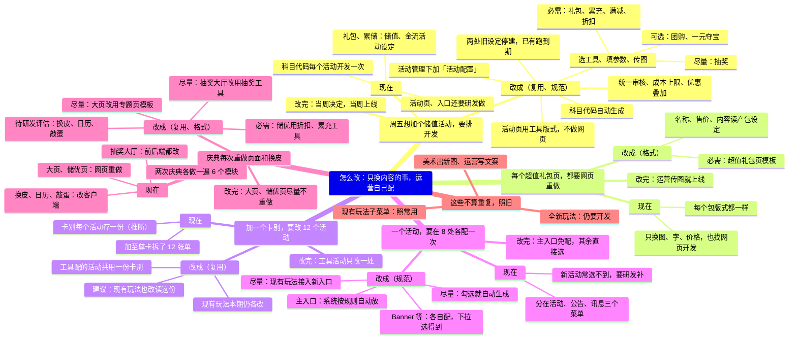

# 怎么改：结合现有后台结构

> 10/29 晚。依据：10/28 后台实看（`资料/后台菜单结构_实看_1028.md`）和方案设计稿。每一支是一个「只换内容却要找研发」的问题，下面固定写三层：现在（后台哪里、为什么要研发）、改成（落在后台哪里、怎么做，括号里是它对应主管说的复用、格式、规范哪一项）、改完（运营那边有什么不同）；最后一支写不算重复、照旧的。分档写在节点开头：必需＝本期一定做，尽量＝本期尽量做，可选＝排在最后，待研发评估＝能不能做要研发先评估。两段代码内容相同，讲解页用 Mermaid 那段。

## 一、Markdown

```markdown
# 怎么改：只换内容的事，运营自己配

## 周五想加个储值活动，要排开发
### 现在
- 礼包、累储：储值、金流活动设定
- 活动页、入口还要研发做
- 科目代码每个活动开发一次
### 改成（复用、规范）
- 活动管理下加「活动配置」
- 选工具、填参数、传图
  - 必需：礼包、累充、满减、折扣
  - 尽量：抽奖
  - 可选：团购、一元夺宝
- 活动页用工具版式，不做网页
- 统一审核、成本上限、优惠叠加
- 科目代码自动生成
- 两处旧设定停建，已有跑到期
### 改完：当周决定，当周上线

## 每个超值礼包页，都要网页重做
### 现在
- 每个包版式都一样
- 只换图、字、价格，也找网页开发
### 改成（格式）
- 必需：超值礼包页模板
- 名称、售价、内容读产包设定
### 改完：运营传图就上线

## 加一个卡别，要改 12 个活动
### 现在
- 卡别每个活动存一份（推断）
- 加至尊卡拆了 12 张单
### 改成（复用）
- 工具配的活动共用一份卡别
- 现有玩法本期仍各改
- 建议：现有玩法也改读这份
### 改完：工具活动只改一处

## 一个活动，要在 8 处各配一次
### 现在
- 分在活动、公告、讯息三个菜单
- 新活动常选不到，要研发补
### 改成（规范）
- 主入口：系统按规则自动放
- Banner 等：各自配，下拉选得到
- 尽量：勾选就自动生成
- 尽量：现有玩法接入新入口
### 改完：主入口免配，其余直接选

## 庆典每次重做页面和换皮
### 现在
- 两次庆典各做一遍 6 个模块
- 大页、储优页：网页重做
- 抽奖大厅：前后端都改
- 换皮、日历、敲蛋：改客户端
### 改成（复用、格式）
- 尽量：大页改用专题页模板
- 必需：储优用折扣、累充工具
- 尽量：抽奖大厅改用抽奖工具
- 待研发评估：换皮、日历、敲蛋
### 改完：大页、储优页尽量不重做

## 这些不算重复，照旧
### 美术出新图、运营写文案
### 全新玩法：仍要开发
### 现有玩法子菜单：照常用
```

## 二、Mermaid


