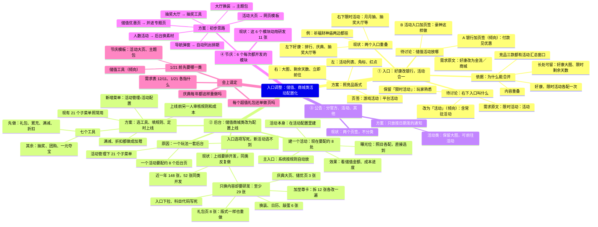

# 需求评审材料：脑图版

> 10/29 下午按讲解模式重写：节点只写短语、每个不超过 16 个字宽（讲解页一行约放 16 个字），同一层同一种写法，每个节点下不超过 6 个，细节放下一层。内容与 `需求评审材料.pptx` 一致，没有新增结论；成本预警、横竖版等细节只在 PPT 和带备注版里。两段代码内容相同，按工具选一段粘贴。最后一支「会上请定」在 PPT 里只写在备注，不想摆出来就删掉这一支。

## 一、Markdown（XMind、幕布、知犀、GitMind、markmap 等）

```markdown
# 入口调整：储值、商城类活动配置化

## ① 入口：好康改银行，活动合一
### 现状：两个入口重叠
- 左下好康：排行、庆典、抽奖大厅等
- 右下限时活动：月月抽、抽奖大厅等
- 例：祈福财神庙两边都挂
### 依据：为什么能合并
- 内容重叠
- 好康、限时活动各配一次
- 竞品三款都有活动汇总窗口
- 长处可留：好康大图、限时剩余天数
### 方案：照竞品版式
- 页签：游戏活动｜平台活动
- 左：活动列表、角标、红点
- 右：大图、剩余天数、立即前往
### 待讨论：右下入口叫什么
- 需求原文：限时活动：活动
- 保留「限时活动」：玩家熟悉
- 改为「活动」（倾向）：含常驻活动
### 待讨论：储值活动放哪
- 需求原文：好康改为金流／商城
- A 银行加页签（倾向）：付款见优惠
- B 活动入口加页签：豪神这样做

## ② 后台：储值商城类改为配置上线
### 现状：上线要排开发，同类反复做
- 近一年 148 张，52 张同类开发
- 只换内容却要研发：至少 29 张
  - 礼包页 8 张：版式一样也重做
  - 庆典大页、储优页 3 张
  - 换装、日历、敲蛋 6 张
  - 加至尊卡：拆 12 张各改一遍
  - 入口下拉、科目代码写死
### 原因：一个玩法一套后台
- 活动管理下 21 个子菜单
- 一个活动要配约 8 个后台页
- 入口选项写死，新活动选不到
### 方案：选工具、填规则、定时上线
- 七个工具
  - 先做：礼包、累充、满减、折扣
  - 其余：抽奖、团购、一元夺宝
- 新增菜单：活动管理›活动配置
- 现有 21 个子菜单照常用
- 上线前另一人审核规则和成本
- 满减、折扣都做成加赠
### 建一个活动：现在要配约 8 处
- 活动本身：在活动配置里建
- 主入口：系统按规则自动放
- 曝光位：照旧各配，直接选到
- 效果：看储值金额、成本进度

## ③ 公告：分官方、活动、其他
### 现状：两个页签，不分类
### 方案：只放按日期发的通知
- 活动类：保留大图，可前往活动

## ④ 节庆：6 个每次都开发的模块
### 现状：这 6 个模块动用研发 11 张
### 方案：初步思路
- 活动大页 → 网页模板
- 储值优惠页 → 并进专题页
- 抽奖大厅 → 抽奖工具
- 人数活动 → 后台换素材
- 大厅换装 → 主题包
- 导航弹窗 → 自动列出排期

## 会上请定
### 需求表 12/11、1/21 各指什么
### 庆典每年都这样重做吗
### 每个超值礼包还单做页吗
### 1/21 前先要哪一类
- 储值工具（倾向）
- 节庆模板：活动大页、主题包
```

## 二、Mermaid（飞书文档「文本绘图」、ProcessOn、Notion、讲解页）


