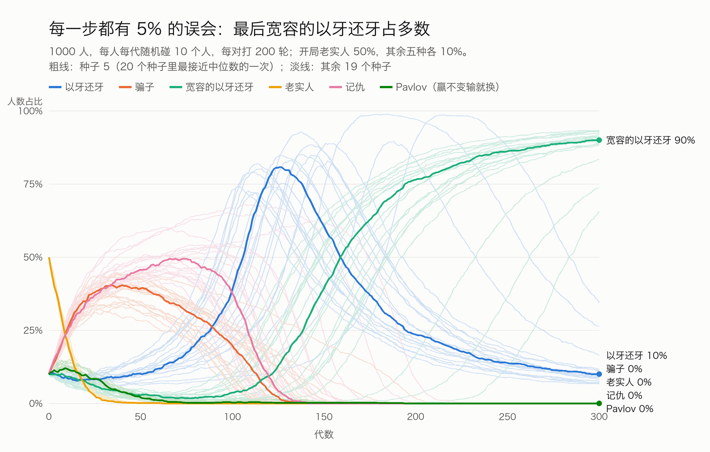
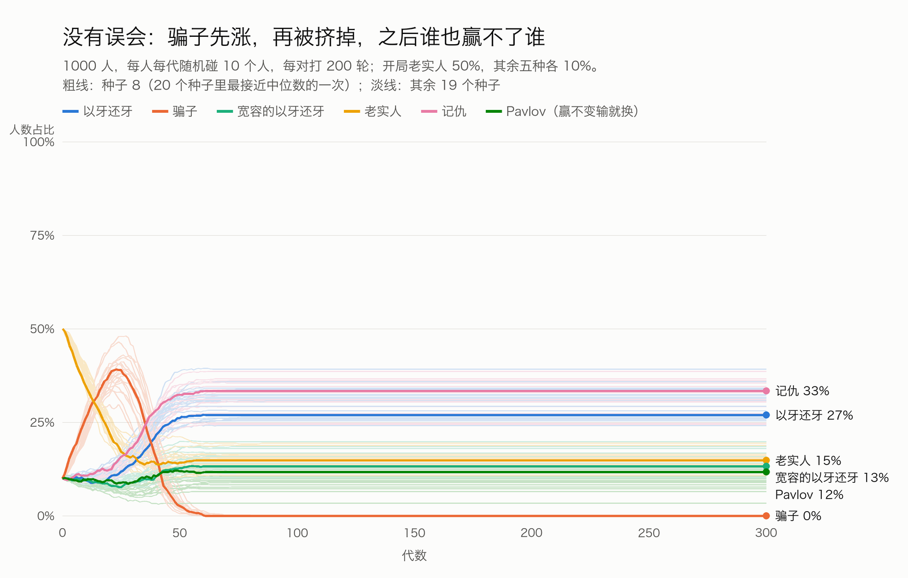
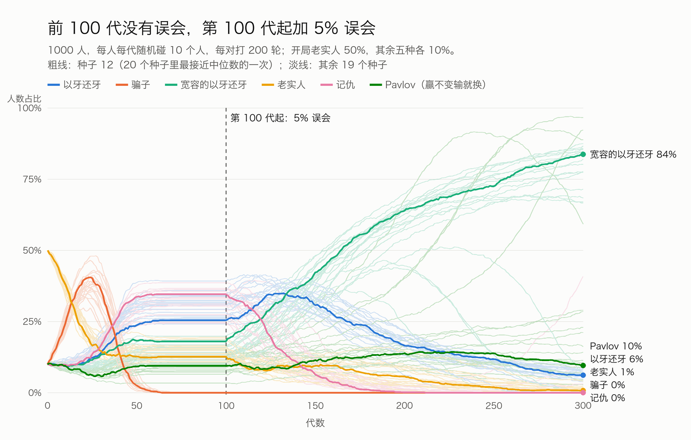
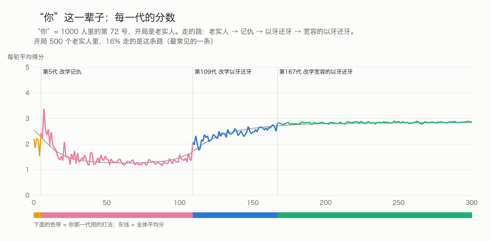

# 情节大体跑得出来，但要改三处说法：老实人不只被骗子吃，记仇的人先赢一阵，“加误会”最好改成“误会一直都在”

仿真：1000 人重复囚徒困境，六种打法，按分差模仿。两个主场景各 20 个种子，参数扫描 44 格，每格 10 个种子。

| 结论 | 数字 | 对片子的意思 |
|---|---|---|
| 有 5% 误会时，四步全部成立 | 20 个种子 20 次成立；终局宽容的以牙还牙中位 90% | 推荐用这一组做画面（种子 5） |
| 没有误会时，老实人不会被骗光，也分不出输赢 | 老实人最低中位 13%（50% 起步）；第 60 代后一切冻结 | “老实人被骗光”只能放在有误会的世界里讲 |
| 结局有前提 | 每对只打 10 轮以内、误会到 10%、“看 3 人学最高”时，宽容的都没赢 | 片尾要说“在这个世界里”，不能说“科学证明” |

---

## 先说短板

- **六种打法是我们挑的。** 换一套打法，结局可能不同。论文里用的是连续的概率型打法，我们是离散的六种。
- **没有空间、没有熟人。** 每代随机碰 10 个人，下一代又重新随机。现实里人会选朋友、会记名声，这些都没放。
- **“被淘汰”其实是“改学了别人”。** 模型里没人死。说“老实人没了”，意思是没人再当老实人。
- **只跑 300 代。** 加了突变跑 1000 代，会出现循环：宽容的多了，Pavlov 或骗子会再起来（见第五节）。宽容的不是永久终点。
- **收益用标准值 5/3/1/0。** 这组数恰好让 Pavlov 碰上骗子时处在临界点（骗子从它身上平均每轮拿 3 分，等于两人都合作的 3 分），对 Pavlov 不利。

---

## 一、模型怎么设

**六种打法**

| 打法 | 规则 |
|---|---|
| 老实人 | 永远合作 |
| 骗子 | 永远背叛 |
| 以牙还牙 | 第一步合作，之后照搬对方上一步 |
| 宽容的以牙还牙 | 对方合作就合作；对方背叛，仍有 1/3 的概率合作（另试 10%） |
| 记仇 | 先合作；对方背叛一次，就永远背叛 |
| Pavlov（赢了不变，输了就换） | 上一步得 3 或 5 分就照旧，得 0 或 1 分就换 |

**一代里发生什么**
- 1000 人。开局老实人 50%，其余五种各 10%。
- 每人随机碰 10 个人（随机两两配对 10 次）。
- 每一对连打 200 轮。
- 每轮收益：都合作各得 3；都背叛各得 1；一方背叛一方合作，背叛的得 5，合作的得 0。
- 一个人这一代的分 = 他所有轮的平均分（0 到 5）。

**误会**
- 每一轮，每个人的动作有 5% 的概率做反：想合作变成背叛，或反过来。
- 对方看到的是做反后的动作，并按它反应。
- 另试：1%、10%；以及“动作不错、但 5% 看反”。

**一代打完怎么变**
- 每人随便看一个别人。
- 别人分比我高，就以“分差 ÷ 5”的概率改学他的打法。分不比我高，不改。
- 这是“按分差比例模仿”（Schlag 1998 的模仿规则），整体上接近教科书里的复制者动态。
- 主场景不加突变：没人用的打法不会自己回来。
- 另试三种规则：Fermi 规则；看 3 个人学最高的；按分数比例繁殖（Wright-Fisher）。

**跑多少**
- 300 代。主场景每个 20 个种子；参数扫描每格 10 个种子。
- 全部随机数来自种子，能复现。

---

## 二、结果：有误会时情节完整，没误会时停在一半

### 有 5% 误会：四幕都出来了（20 个种子，20 次）



| 幕 | 发生了什么 | 20 个种子的中位数（最小–最大） |
|---|---|---|
| 1 | 老实人跌破 1% | 第 35 代（32–40） |
| 2 | 骗子涨到峰值 | 40%（31–45%），第 37 代 |
| 2′ | 记仇的人同时涨，比骗子还多 | 峰值 50%（43–68%） |
| 3 | 骗子的平均分跌到以牙还牙之下 | 第 23–31 代 |
| 3 | 以牙还牙涨到峰值 | 83%（72–99%） |
| 3 | 骗子跌破 1% | 第 132 代（105–204） |
| 4 | 宽容的以牙还牙终局第一 | 20/20；终局 90%（57–93%）；以牙还牙剩 10%（7–43%） |
| 4 | 终局合作率 | 86%（78–87%） |

- Pavlov 在这组里没赢过：20 次都跌破 1%，中位第 63 代（51–139）。

### 没有误会：骗子先涨再被挤掉，然后一切冻结



- 老实人从 50% 掉到中位 13%（9–19%），**20 次里 0 次跌破 1%**。
- 骗子峰值 39%（30–48%），第 24 代；第 55 代左右消失。
- 骗子一消失，所有人都合作，分数完全一样，就没人再改。
- 终局谁也没过半：记仇第一 13 次、以牙还牙第一 7 次。
- 原因：没有误会时，记仇和以牙还牙的行为一模一样（都是对方先背叛才背叛），谁多谁少只看运气。

### 中途加误会（第 100 代起 5%）：多数也是宽容的赢



- 前 100 代和“没有误会”完全一样。
- 加误会后，最先垮的是记仇的人（中位峰值 33%；20 次里 18 次跌破 1%，中位第 185 代），然后是以牙还牙。
- 终局第一：宽容的 16 次，Pavlov 4 次（20 次里）。宽容的终局中位 77%。
- 老实人在 13/20 次里最终跌破 1%，但要到第 260 代左右。

### 为什么：两两打 200 轮的平均分（5% 误会）

| 打法和自己人打 | 每轮平均分 | 合作的轮数占比 |
|---|---|---|
| 老实人 | 2.95 | 95% |
| 宽容的以牙还牙 | 2.86 | 88% |
| Pavlov | 2.78 | 87% |
| 以牙还牙 | 2.29 | 52% |
| 记仇 | 1.25 | 10% |

| 老实人碰到谁 | 老实人每轮得分 | 对方每轮得分 |
|---|---|---|
| 骗子 | 0.20 | 4.70 |
| 记仇 | 0.48 | 4.53 |
| Pavlov | 1.62 | 3.80 |
| 以牙还牙 | 2.81 | 3.03 |

- 有误会时，记仇的人对老实人几乎和骗子一样狠：老实人手滑一次，记仇的就永远背叛，而老实人还一直合作。
- 两个以牙还牙碰上，一次误会就变成“你一下我一下”，只有一半的轮在合作。
- 完整收益表：`results/payoff_matrix.json`（误会 0、1%、5%、10% 四张）。

---

## 三、情节逐步核对

| 打算的情节 | 跑出来了吗 | 条件 | 要怎么改说法 |
|---|---|---|---|
| 老实人先被骗光 | **有误会时成立**（20/20） | 要有误会；无误会时只掉到 13% 左右 | 不只是骗子：记仇的和 Pavlov 也在吃老实人。“骗光”= 没人再当老实人。种子 5 那次：500 个开局老实人，第一次改学时 37% 学成骗子、33% 学成记仇 |
| 骗子越来越多 | **成立**（两个主场景都是 20/20），峰值约 40% | 开局老实人要多。六种平均分时骗子不涨（峰值 17–23%） | 可以照说 |
| 以牙还牙冒出来，骗子没人可骗，变少 | **成立**（20/20） | 开局要有以牙还牙。开局没有、只靠突变冒出来时，有误会的世界 10 次里 8 次是记仇赢、合作率 12% | 有误会时，先涨起来的是记仇的人（一半人），以牙还牙到第 100 代后才把骗子和记仇一起挤掉。无误会时，记仇和以牙还牙一起涨，分不出谁 |
| 加 5% 误会，以牙还牙互相报复，宽容的赢 | **成立**：从头有误会 20/20；中途加 16/20 | 误会 1–5%；每对至少约 50 轮；人数 1000 | 推荐改成“误会一直都在”：骗子在的时候，以牙还牙的狠是保护；骗子没了，这份狠只伤自己人 |

**意外**
- **记仇的人一度最多。** 有误会时，骗子横行那段，记仇的涨到 50%，比骗子还多。靠的是吃手滑的老实人。
- **记仇在几种条件下直接赢了：** 误会 10%（9/10）、“看 3 人学最高”（7/10）、开局没有以牙还牙（8/10）。这几种情况下合作率只剩 10–12%，赢的“记仇”其实就是天天在背叛。
- **Pavlov 偶尔赢。** 从头有误会时 0/20；中途加误会 4/20；突变 1% 时 3/10。它碰上骗子最吃亏（每轮 0.67 分，骗子从它身上拿 2.93 分），骗子多的时候它先死。
- **单挑和群体是反的。** 没有误会时，以牙还牙在任何一局里都没比对手分高过（最多打平）。有误会时，它单挑宽容的以牙还牙，99% 的局都赢；但在 1000 人里输的是它。

---

## 四、参数敏感性：结局对“关系长短、误会多少、学得多猛”敏感


完整表：`results/敏感性.md`。下面只列会改结局的。

| 改了什么 | 有误会时谁赢（10 次） | 说明 |
|---|---|---|
| 每对只打 1 或 3 轮 | 骗子 10 | 关系太短，合作起不来，合作率 0–5% |
| 每对打 10 轮 | 以牙还牙 9 | 关系短时，宽容来不及回本 |
| 每对打 50 轮 | 宽容 10 | 和 200 轮一样 |
| 误会 1% | 宽容 10 | 但老实人只有 5 次被骗光 |
| 误会 10% | 记仇 9 | 合作崩了，合作率 11% |
| 动作不错、5% 看反 | 宽容 9 | 和动作出错差不多 |
| 开局只有老实人和骗子（其余靠突变） | 骗子 10 | 合作率 6%；没有误会时以牙还牙和记仇能翻盘（10/10） |
| 开局没有以牙还牙 | 记仇 8 | 以牙还牙是开路的，少了它合作起不来 |
| 看 3 个人学最高的 | 记仇 7 | 学得太猛，一种打法很快占满全场 |
| Fermi / 按分数比例繁殖 | 宽容 7，以牙还牙 3 | 方向一样，慢一些 |
| 全体循环（200 人） | 宽容 7，以牙还牙 3 | 方向一样 |
| 人数 300 | 宽容 4，记仇 3，以牙还牙 3 | 小群体运气成分大 |
| 突变 1% | 宽容 7，Pavlov 3 | 跑 1000 代会循环 |
| 宽容度 10% | 宽容 9 | 1/3 和 10% 同时放，1/3 赢 10/10 |
| 不放 Pavlov | 宽容 10 | 和基准一样 |
| 骗子开局 2% 或 30% | 宽容 9 / 10 | 骗子 2%、没有误会时，骗子照样涨到 39% |

**结局成立的条件（推断，依据是上表）**：关系够长（每对约 50 轮以上）；误会不大不小（1–5%）；开局有以牙还牙；学别人时按分差慢慢学。

---

## 五、推荐画面用：5% 误会、种子 5

- 参数：1000 人，每代碰 10 人，每对 200 轮，误会 5%，开局老实人 50%，其余五种各 10%，宽容度 1/3，按分差模仿，不加突变，300 代。
- 种子 5 是 20 个种子里最接近中位数的一次（按终局比例、骗子峰值、老实人最低点、记仇峰值和两个关键代数算距离），不是挑出来好看的。

**这一次的关键代数（给分镜用）**

| 代 | 事件 |
|---|---|
| 0 | 老实人 500、其余各 100 |
| 25 | 骗子的平均分第一次低于以牙还牙 |
| 32 | 老实人跌破 1% |
| 34 | 骗子到顶：405 人 |
| 66 | 记仇到顶：494 人 |
| 126 | 以牙还牙到顶：808 人 |
| 129 | 骗子跌破 1% |
| 159 | 宽容的以牙还牙人数超过以牙还牙 |
| 300 | 宽容 900、以牙还牙 100，合作率 86% |

**“你”这一条线：老实人 → 记仇 → 以牙还牙 → 宽容**



- “你”是 1000 人里的第 72 号，在点阵里是第 17 个点（`you_dot`）。
- 怎么选的：在 500 个开局老实人里，找最常见的一条“改学路线”，再挑换打法时间最接近这条路线中位数的人。
- 这条路线有 80 人走（500 人的 16%），是最常见的一条。第二常见：老实人 → 骗子 → 以牙还牙 → 宽容，71 人（14%）。
- 500 个开局老实人，最后 455 人是宽容的、45 人是以牙还牙。

| 代 | 你是 | 发生了什么 |
|---|---|---|
| 0–4 | 老实人 | 第 4 代碰到 4 个骗子，2000 轮里被背叛 1028 次。还碰到一个记仇的：你手滑 6 次，他就背叛了你 161 次。每轮 1.53 分，只比 6% 的人高 |
| 4 | | 你看到一个记仇的人每轮 3.44 分，学了他 |
| 7 | 记仇 | 碰到 6 个老实人。他们每人手滑 6–11 次，你之后一直背叛他们，从每人身上每轮拿 4.6–4.7 分。这一代你比 99% 的人分高 |
| 25–100 | 记仇 | 身边全是记仇和骗子。每轮 1.1–1.7 分，2000 轮里被背叛 1550–1880 次 |
| 108 | | 10 个对手里 8 个是以牙还牙。你看到一个以牙还牙 2.00 分，比你的 1.37 高，学了他 |
| 109–166 | 以牙还牙 | 每轮 1.8–2.8 分，跟着全场一起涨；但第 166 代只比 7% 的人高：你在和别的以牙还牙互相报复 |
| 166 | | 你看到一个宽容的人 2.81 分，学了他 |
| 167–300 | 宽容 | 每轮 2.8–2.9 分；2000 轮里被背叛的次数从 700 多降到 210–370 次 |

**数据文件（`visual/`）**

| 文件 | 内容 |
|---|---|
| `pop_误会5%.json` | 1000 人每代各打法人数（`counts`）、各打法平均分、合作率、上表关键代数（`events`）、配色 |
| `dots_误会5%.json` | 从 1000 人里固定抽 300 人，每代每点的打法编号 `s[代][点]` 和分数 `p[代][点]`；同一个点始终是同一个人；`you_dot` = 17 |
| `you_误会5%.json` | 你每代碰到的 10 个人是什么打法、你在每局的平均分、被背叛几次、你和对方各手滑几次、你看了谁、改没改 |
| `*_转折_第100代起误会5%.json` | 备选：中途加误会的版本（种子 12），同样三份 |

- 配色：每个打法给了浅底、深底两套色（`color_light` / `color_dark`），按色弱安全的顺序分配并校验过。

---

## 六、建议片子里怎么说

**可以说（都是我们自己跑出来的）**
- “1000 个人，一半是老实人。谁都会手滑：每一步有 5% 的可能做反。”
- “30 多代，老实人只剩不到百分之一；60 多代，一个不剩。不是死了，是不当了。”（种子 5：第 32 代跌破 1%，第 62 代归零）
- “骗子涨到四成。但最多的不是骗子，是记仇的人：一度占一半。”
- “你手滑一次，记仇的人就再也不对你好。老实人碰上他们，和碰上骗子差不多惨。”
- “老实人没了，骗子没人可骗，分数跌到以牙还牙下面。”
- “以牙还牙涨到八成，骗子和记仇的一起消失。”
- “然后，以牙还牙开始互相报复。两个以牙还牙碰上，只有一半的时间在合作。”
- “最后，九成的人是会原谅的那种。”
- “单挑，会原谅的人九成九输给以牙还牙。可在 1000 个人里，赢的是他。”
- 落点：“只会对人好，在这个世界里会被吃光。先对人好、被骗会还手、但肯原谅，才活到最后。”

**要改的说法**
- “老实人被骗子骗光” → “老实人被骗子和记仇的人吃光”；并且只在有误会时成立。
- “转折：加了误会” → “误会一直都在。骗子在的时候，以牙还牙的狠是保护；骗子没了，这份狠只伤自己人。”（如果要保留“加误会”的转折，用备选数据，但要知道 20 次里有 4 次是 Pavlov 赢。）
- “以牙还牙冒出来” → “以牙还牙涨起来”。开局就有它；全靠凭空冒出来的话，有误会时 10 次里 8 次起不来。

**不能说**
- “科学证明宽容的人一定赢”：关系太短、误会太多、学得太猛时都不赢。要说就说“在这个设定里”。
- “以牙还牙是最好的策略”：它在没有误会时赢，有误会时输给宽容的。
- “Pavlov 被证明不行”：我们的打法和论文不同；在论文的设定里它赢了。
- “1000 人 200 轮”：会被听成 200 代。200 是每对打的轮数，300 是代数。
- 把“改学”说成“死亡”或“淘汰”。

---

## 七、出处核对

**1. Axelrod 1980 两次电脑比赛：站得住**
- 原文：Axelrod, R. (1980). Effective Choice in the Prisoner's Dilemma. *Journal of Conflict Resolution* 24(1): 3–25；More Effective Choice in the Prisoner's Dilemma. 同刊 24(3): 379–403。
- 第一次：14 个程序，加一个随机出手的程序，循环赛，每对 200 步。以牙还牙得分最高，也是最简单的。
- 第二次：62 个程序（加随机程序共 63 个），来自 6 个国家，参赛者事先看过第一次结果；每局长度随机。以牙还牙又是第一。
- 以牙还牙由多伦多大学的 Anatol Rapoport 提交，两次都是他。
- 核对来源：Axelrod 1984 年书《The Evolution of Cooperation》的摘录（第二次“又由第一次的赢家 Rapoport 提交”）；Rapoport, Seale & Colman 2015 年 *PLOS ONE* 的复盘（14+1、62+1、200 步、5/3/1/0）。没看到 1980 年两篇的全文。
- 片子里可以说：“1980 年，一个叫 Axelrod 的学者办了两次电脑比赛，第一次 14 个程序，第二次 62 个。两次都是同一个最简单的程序赢：以牙还牙。”
- 不能说：
  - “Axelrod 发明了以牙还牙”：是 Rapoport 提交的。
  - “以牙还牙打败了所有对手”：它按总分赢，单局从不比对手高（这一点我们的仿真也验证了）。
  - “以牙还牙被证明是最优”：2015 年那篇复盘认为它的成绩取决于比赛设计、评分方式和收益数值。

**2. Nowak & Sigmund 1992《自然》：站得住，细节要留余地**
- 原文：Nowak, M. & Sigmund, K. (1992). Tit for tat in heterogeneous populations. *Nature* 355: 250–253。全文在付费墙后，没看到。
- 摘要层面的结论：一小撮以牙还牙对合作冒头是必要的，但它只是给更宽容的打法铺路。
- 他们的设定：随机抽出的约 100 种概率型“反应”打法，带随机性。多数试验最后滑向全背叛；以牙还牙附近的打法在场时，局面才翻过来，最后宽容的胜出（斯坦福哲学百科和二手文献转述）。
- 这和我们的结果一致：开局没有以牙还牙时，有误会的世界 10 次里 8 次合作起不来。
- 原谅的概率：二手资料普遍说是 1/3（用 5/3/1/0 收益算出来的上限）。斯坦福哲学百科按另一种定义写的是 25%。所以数字不要说死。
- 片子里可以说：“1992 年，Nowak 和 Sigmund 在《自然》上发现：以牙还牙是开路的，最后赢的是会原谅的版本。我们自己跑了一遍，结果一样。”
- 不能说：“论文证明原谅率必须是三分之一”；“他们用的就是我们这个模型”。

**3. Nowak & Sigmund 1993《自然》：站得住，但和我们的结果不同**
- 原文：Nowak, M. & Sigmund, K. (1993). A strategy of win-stay, lose-shift that outperforms tit-for-tat in the Prisoner's Dilemma game. *Nature* 364: 56–58。全文在付费墙后，看了 PubMed 摘要。
- 结论：长时间演化（带突变）里，Pavlov（赢了不变输了就换）表现出乎意料地好。两个长处：能从偶然的失误里恢复；能占老实人的便宜，所以老实人不会泛滥、给骗子开门。
- 斯坦福哲学百科转述的数：跑 1000 万代后，90% 的试验达到稳定合作；其中 91.7% 由接近 Pavlov 的打法主导，以牙还牙或宽容的不到 8.3%。该词条也写了它的短板：骗子多时表现差。
- 我们的结果：从头有误会时 Pavlov 0/20；中途加误会 4/20；突变 1% 时 3/10。差别来自打法空间、突变和代数不同，不是谁对谁错。
- 片子里可以说：“一年后，他们又找到一个更简单的规则：赢了不变，输了就换。在他们的长时间模拟里，它比以牙还牙更好。在我们这一版里，它碰上骗子太吃亏，没撑过去。”
- 不能说：“我们推翻了这篇论文。”

**核对过的链接**
- [Rapoport, Seale & Colman 2015, PLOS ONE（PMC4520619）](https://pmc.ncbi.nlm.nih.gov/articles/PMC4520619)
- [Axelrod 1984 书摘（IIT Kanpur 书评页）](https://www.cse.iitk.ac.in/users/amit/books/axelrod-1984-evolution-of-cooperation.html)
- [Axelrod 1980b 题录（IDEAS/RePEc）](https://ideas.repec.org/a/sae/jocore/v24y1980i3p379-403.html)
- [Nowak & Sigmund 1992, Nature 页面](https://www.nature.com/articles/355250a0)
- [Nowak & Sigmund 1993, PubMed 8316296](https://pubmed.ncbi.nlm.nih.gov/8316296/)
- [斯坦福哲学百科 Prisoner's Dilemma 词条](https://plato.stanford.edu/entries/prisoner-dilemma/)
- [Nowak 2006, Five rules for the evolution of cooperation（PMC3279745）](https://pmc.ncbi.nlm.nih.gov/articles/PMC3279745/)

---

## 八、文件和复现

| 文件 | 作用 |
|---|---|
| `sim.py` | 模型本身（打法、对局、模仿、记录“你”） |
| `experiments.py` | 跑主场景、转折场景、参数扫描、收益表（8 进程约 13 分钟） |
| `analyze.py` | 汇总多种子、选代表性种子、写 `results/敏感性.md` |
| `export_visual.py` | 导出画面数据：`python export_visual.py 误会5% 5` |
| `plots.py` | 用 Pillow 出 `figs/` 里的图 |
| `results/` | 每个种子的完整曲线和指标（`main_*.json`）、扫描指标（`sweep_raw.json`）、汇总（`summary.json`） |

复现：

```
cd /Users/decheng.huang/Documents/dy/videos/002_做好人/sim
/Users/decheng.huang/Documents/dy/.venv/bin/python experiments.py
/Users/decheng.huang/Documents/dy/.venv/bin/python analyze.py
/Users/decheng.huang/Documents/dy/.venv/bin/python export_visual.py 误会5% 5
/Users/decheng.huang/Documents/dy/.venv/bin/python export_visual.py 转折_第100代起误会5% 12
/Users/decheng.huang/Documents/dy/.venv/bin/python plots.py
```

**情节各步的判定标准**（`experiments.py` 里的 `metrics`）
- 老实人被骗光：某一代跌破 1%。
- 骗子变多：峰值至少是开局的 1.5 倍，且不在第 0 代。
- 以牙还牙起来、骗子消失：骗子到顶之后，以牙还牙的峰值至少是“骗子到顶那一代”和“开局”的 1.5 倍（且不低于 5%），出现在骗子到顶之后；骗子终局低于 1%。
- 宽容的赢：终局（最后 20 代平均）宽容的多于以牙还牙，且是第一。
- 突变 1% 时，突变一直补人，“跌破 1%”这类判定会不成立，看表时要注意。
