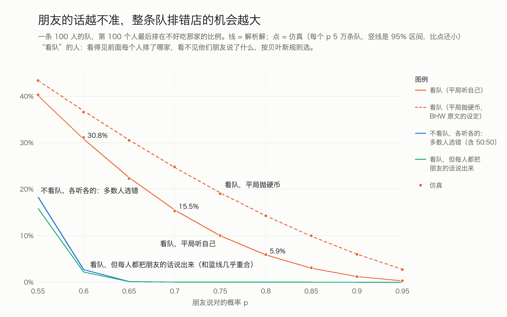
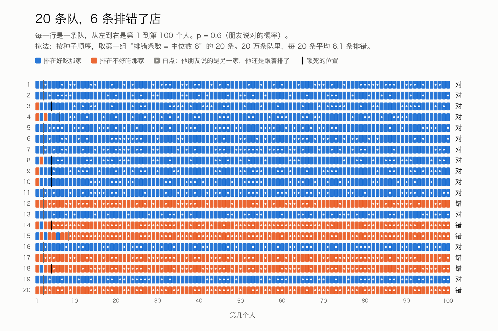
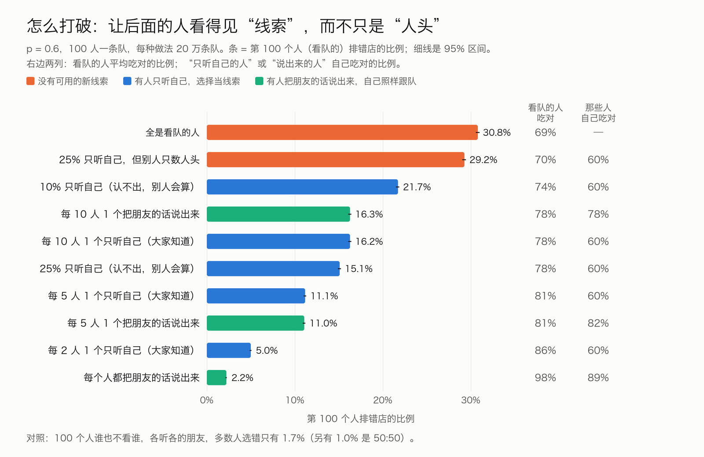
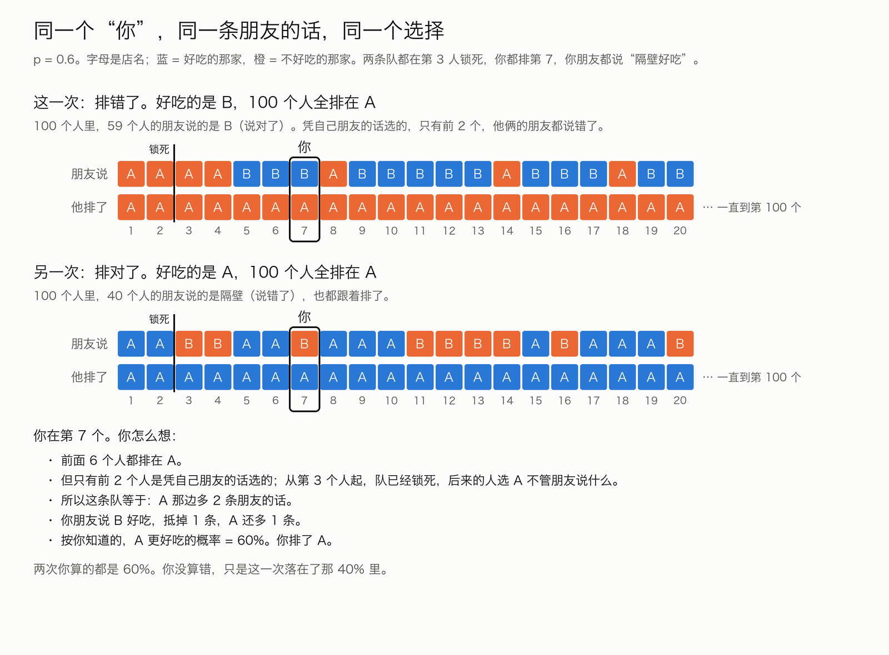

# 排错店的队里，大多数人的朋友其实说对了；“三成排错”只在朋友的话六成准时成立

仿真：两家店，一家真的更好吃；100 人依次来，每人有一句朋友的话（准的概率 p），看得见前面的人排了哪家，按贝叶斯规则选。每个场景 20 万条队，结果和解析解逐一对上。

| 结论 | 数字（p = 0.6，平局听自己） | 对片子的意思 |
|---|---|---|
| 理性的人也会整队排错 | 第 100 人排错 30.8%（解析解 30.8%） | “三成多”只在 p ≈ 0.6 时成立；p = 0.7 时 15.5%，p = 0.8 时 5.9% |
| 不看队反而不会集体错 | 各听各的：多数人选错 1.7%（另 1.0% 是 50:50） | 看队让每个人自己更准（60% → 69%），却让整队一起错的机会从 2% 涨到 31% |
| 长队里只装着前两个人的信息 | 前 2 人同选一家时，那家好吃的概率是 69%；前 100 人都选它，还是 69% | 队从 3 人排到 100 人，可信度一点没涨 |
| 排错的队里，大多数人的朋友说对了 | 平均 59 人（10%–90% 区间 52–65）；这种队里 95% 是多数人拿着对的线索 | 推荐当“最反直觉的数”。对任何 p 都成立，大约是 100 × p 人 |
| 打破办法：把线索说出来 | 每 5 人有 1 人说出朋友的话：31% → 11%；人人都说：2.2% | 说出来的人自己不吃亏；只听自己的人自己吃对只有 60% |

---

## 先说短板

- **吃完不会改主意。** 模型里每人只选一次，吃完也不告诉别人好不好吃。现实里吃过的人会回来说，排错的队过几天可能自己散了。这是最大的短板。
- **只有两家店、一个“更好吃”。** 现实里口味不同，没有唯一的答案。
- **每个人的朋友一样准，而且人人知道 p 是多少。** 现实里有人朋友准，有人不准，也没人知道 p。
- **人人是完美的贝叶斯计算者，也知道别人是。** 真人不是：Anderson 和 Holt 的实验里，队和自己的线索冲突时，约四分之一的人信了自己（见第六节）。我们用“25% 的人只听自己”做了检验。
- **队只是“前面的人选了哪家”。** 没有排队要等多久、价钱、店的翻台速度、雇来的托。现实里队长还受这些影响。
- **p 是我们定的。** “朋友说得对的概率是 60%”没有实测依据，只是一个讲得通的数。所以片子里所有比例都要带着“朋友的话六成准”这个前提。
- **平局怎么处理会改数字。** 主场景用“平局听自己”；BHW 原文用“抛硬币”，排错比例更高（p = 0.6 时 36.8%）。两种都跑了。

---

## 一、模型

**店和真相**
- 两家店 A、B，挨着。每条队开始前随机定一家真的更好吃，各 1/2。
- 店本身没有先验偏好（不像 Banerjee 的例子里 A 有 51%）。

**每个人有什么**
- 一句朋友的话：“A 好吃”或“B 好吃”。说对的概率 p，说错的概率 1 − p。每人的朋友互相独立。
- 看得见前面每个人排了哪家，按到来的顺序。看不见前面的人的朋友说了什么。

**每个人怎么选（看队的人）**
- 按贝叶斯规则算：根据前面每个人的选择能推出什么，加上自己朋友的话，哪家更可能好吃，就排哪家。
- 前面的人的选择能透露他的线索，前提是他当时还会按自己的线索选。一旦一个人不管线索怎样都只会选同一家，他的选择就不再透露任何东西。
- **平局**（两家一样可能）：主场景**听自己朋友的**（Anderson & Holt 1997 的主假设）。另跑**抛硬币**（BHW 1992 原文的假设）。

**这套规则推出来的简单算法（平局听自己）**
- 把“前面透露出来的线索”记成净数 d：A 多一条 +1，B 多一条 −1。开始 d = 0。
- d 在 −1 到 +1 之间：这人照自己朋友的话选；他的选择透露了线索，d 加减 1。
- d 到了 +2 或 −2：**锁死**。这人不管朋友说什么都选多的那家；他的选择不透露任何东西，d 不再变。后面所有人都一样。
- 所以一旦锁死，队里装的信息就是“净多 2 条朋友的话”，不会再变多。

**能不能打破：加几种人**

| 加的人 | 他怎么选 | 后面的人看到什么 |
|---|---|---|
| 只听自己的人（认得出） | 永远按自己朋友的话选 | 大家知道他不看队，所以他的选择 = 他朋友的话 |
| 说出来的人 | 照样理性地跟队 | 他把朋友的话说出来，后面的人听得到 |
| 只听自己的人（认不出） | 永远按自己朋友的话选 | 大家只知道“有 q 比例的人只听自己”，认不出是谁；看队的人把这一点算进去 |
| 同上，但看队的人只数人头 | — | 看队的人把前面每个人的选择都当一票，数哪边多 |

- 第 100 个人在所有场景里都强制是看队的人，方便比较“队尾排错”的比例。

**跑多少**
- 每个场景 20 万条队，每条 100 人。p 扫描每格 5 万条。长队检验 1000 人、4 万条。
- 全部随机数来自固定种子（场景名的 CRC32），能复现。
- 95% 区间用 Wilson 区间。

---

## 二、结果

### 1. 排错比例：仿真和解析解一致



| p | 平局 | 第 100 人排错（仿真，95% 区间） | 解析解 | 无穷长的队 |
|---|---|---|---|---|
| 0.6 | 听自己 | 30.6%（30.4–30.8%） | 30.8% | 30.8% |
| 0.7 | 听自己 | 15.5%（15.3–15.6%） | 15.5% | 15.5% |
| 0.8 | 听自己 | 5.9%（5.8–6.0%） | 5.9% | 5.9% |
| 0.6 | 抛硬币 | 36.9%（36.7–37.1%） | 36.8% | 36.8% |
| 0.7 | 抛硬币 | 24.7%（24.5–24.9%） | 24.7% | 24.7% |
| 0.8 | 抛硬币 | 14.3%（14.2–14.5%） | 14.3% | 14.3% |

- 解析解：平局听自己时，每两人一组，锁对的概率 p²，锁错的概率 (1−p)²，没锁 2p(1−p)。最后锁错的概率 = (1−p)² ÷ [p² + (1−p)²]。
- 抛硬币时就是 BHW 式 (3)：最后锁错的概率 = (2−p)(1−p) ÷ [2(1−p+p²)]。我们用它算的数和仿真一致。
- 队长几乎不影响：p = 0.6 时，10 人队 31.3%，20 人 30.8%，100 人、1000 人都是 30.8%。几个人之内就定了。
- 一旦锁死，多数人和第 100 人一样错：p = 0.6 时“多数人排错”也是 30.6%。

**对照：谁也不看谁，各听各的朋友**

| p | 多数人选对 | 50:50 | 多数人选错 | 每人选对 |
|---|---|---|---|---|
| 0.6 | 97.3% | 1.0% | 1.7% | 60% |
| 0.7 | 约 100% | 0.001% | 0.0% | 70% |
| 0.8 | 约 100% | 0 | 0 | 80% |

- 看队时每人选对：p = 0.6 时 69.1%，p = 0.7 时 84.0%，p = 0.8 时 93.7%。
- **看队对每个人都划算，对整队却是灾难。** p = 0.6：每人选对从 60% 涨到 69%；整队多数人选错从 1.7% 涨到 30.6%。

### 2. 第几个人锁死

| p | 平局 | 第 3 人就锁死 | 解析 | 第 5 人之前 | 第 9 人之前 | 平均第几人 | 解析 |
|---|---|---|---|---|---|---|---|
| 0.6 | 听自己 | 52.0% | 52% | 77.0% | 94.7% | 4.85 | 4.85 |
| 0.7 | 听自己 | 58.0% | 58% | 82.2% | — | 4.46 | 4.45 |
| 0.8 | 听自己 | 67.9% | 68% | 89.8% | — | 3.94 | 3.94 |
| 0.6 | 抛硬币 | 75.9% | 76% | 94.2% | — | 3.63 | 3.63 |

- 平局听自己时，锁死只可能发生在第 3、5、7… 个人（每次要两个人的线索凑成净 2 条）。
- p = 0.6：中位数是第 3 人。锁死前凭自己线索选的人，中位 2 个，平均 3.85 个。
- **早锁死和晚锁死，排错的机会一样。** 每一组两人都是同样的 p² 对 (1−p)²。

### 3. 锁死以后：朋友说“隔壁好”、却还是跟着排了的人

| p | 平局 | 锁死后的人（平均） | 其中朋友说隔壁好 | 占比 | 在排错的队里 | 在排对的队里 |
|---|---|---|---|---|---|---|
| 0.6 | 听自己 | 96.2 | 44.4 | 46.1% | 60% | 40% |
| 0.7 | 听自己 | 96.5 | 34.9 | 36.2% | 70% | 30% |
| 0.8 | 听自己 | 97.1 | 22.8 | 23.5% | 80% | 20% |

- 锁死以后，朋友说隔壁好的人**全部**跟着排了。这是锁死的定义，不是巧合。
- 在排错的队里，朋友说隔壁好的人，朋友其实说对了。

**排错的队（第 100 人在错店）里，100 人中朋友说对了的人**

| p | 平局 | 平均（10%–90% 区间） | 其中站在错店的 | 这种队里多数人朋友说对了 |
|---|---|---|---|---|
| 0.6 | 听自己 | 58.6（52–65） | 57.7 | 95.4% |
| 0.7 | 听自己 | 68.3（62–74） | 67.6 | 100% |
| 0.8 | 听自己 | 78.1（73–83） | 77.6 | 100% |
| 0.6 | 抛硬币 | 59.2（53–65） | 58.8 | 96.1% |

- 大约是 100 × p 人。**朋友越准，排错的队里知道真相的人越多**，可排错的队也越少。
- 排错的队里，约一半（p = 0.6 时 52%）是 100 人全在错店；其余是开头一两个人选对了，后来被锁死的队带走。

### 4. 队有多长，和可不可信没关系

| p | 第 1 人选的那家好吃 | 前 2 人选同一家 | 前 3 人 | 前 10 人 | 前 100 人 |
|---|---|---|---|---|---|
| 0.6 | 60.2% | 69.3% | 69.3% | 69.3% | 69.3% |
| 0.7 | 69.9% | 84.4% | 84.4% | 84.4% | 84.4% |
| 0.8 | 79.9% | 94.1% | 94.1% | 94.1% | 94.1% |

- 前 2 人选了同一家，第 3 人起就锁死了，后面的人只是复制。所以 3 人的队和 100 人的队，可信度一样。
- 解析：p² ÷ [p² + (1−p)²]。抛硬币规则下也是锁死后不再变，数值是 63.2%（p = 0.6）。
- 注意：**不是“队越长越不可信”**，是“队长不再加分”。排队那家仍然更可能好吃（69% > 50%）。

### 5. 20 条队一组



- p = 0.6，20 万条队切成 1 万组、每组 20 条：平均 6.1 条排错；10%/50%/90% 分位 4、6、9 条；4–8 条的概率 78%。
- 画面用的那一组：按种子顺序，取第一组“排错 = 中位数 6 条”的（试到第 7 组）。不是按好看挑的。
- 这 20 条里：12 条第 3 人锁死，6 条第 5 人，1 条第 7 人，1 条第 9 人。排错的 6 条是第 12、14、15、17、18、20 条。

### 6. 能不能打破



**p = 0.6，100 人**

| 做法 | 第 100 人排错 | 精确递推 | 看队的人吃对 | 那些人自己吃对 |
|---|---|---|---|---|
| 全是看队的人 | 30.8%（30.6–31.0%） | 30.8% | 69% | — |
| 25% 只听自己，别人只数人头 | 29.2%（29.0–29.4%） | — | 70% | 60% |
| 10% 只听自己，认不出，别人会算 | 21.7%（21.5–21.9%） | — | 74% | 60% |
| 每 10 人 1 个把朋友的话说出来 | 16.3%（16.1–16.4%） | 16.2% | 78% | 78% |
| 每 10 人 1 个只听自己（大家知道） | 16.2%（16.1–16.4%） | 16.2% | 78% | 60% |
| 25% 只听自己，认不出，别人会算 | 15.1%（14.9–15.2%） | — | 78% | 60% |
| 每 5 人 1 个只听自己（大家知道） | 11.1%（11.0–11.3%） | 11.2% | 81% | 60% |
| 每 5 人 1 个把朋友的话说出来 | 11.0%（10.9–11.2%） | 11.2% | 81% | 82% |
| 每 2 人 1 个只听自己（大家知道） | 5.0%（4.9–5.1%） | 5.0% | 86% | 60% |
| 每个人都把朋友的话说出来 | 2.2%（2.1–2.3%） | 2.2% | 98% | 89% |

**p = 0.7 时同样的做法**：基准 15.7%；每 10 人 1 个说出来 2.5%；每 5 人 1 个 0.7%；25% 只听自己、别人会算 1.8%；25% 只听自己、别人只数人头 13.8%。

**更长的队（p = 0.6，1000 人）**

| 做法 | 第 100 人排错 | 第 1000 人排错 |
|---|---|---|
| 全是看队的人 | 31.2% | 31.2% |
| 每 5 人 1 个只听自己（大家知道） | 11.2% | 0.1% |
| 25% 只听自己，认不出，别人会算 | 15.4% | 0.4% |
| 25% 只听自己，别人只数人头 | 29.3% | 29.3% |

读法：
- **“说出来”和“只听自己（大家知道）”对后面的人效果一模一样**（都是把一句朋友的话公开了）。区别只在那个人自己：说出来的人照样跟队，自己吃对 78–82%；只听自己的人，自己只有 60%。
- **只听自己的人有没有用，取决于后面的人怎么看他。** 后面的人只数人头，25% 的人信自己，排错只从 31% 降到 29%；1000 人也降不下去。后面的人知道“队里大多是跟的”，把逆着队走的人当成一条线索，就降到 15%，长了能降到 0。
- **25% 这个数有出处**：Anderson & Holt 的实验里，队和自己线索冲突时，26% 的人信了自己。“只听自己的人”在不冲突时和看队的人选的一样，所以“25% 只听自己”就等于“冲突时四个人里一个信自己”。

### 7. “你”一个人能做什么

条件：p = 0.6，你排第 7，队已锁死（净 2 条线索），你朋友说隔壁好。后面还有 93 人。精确递推，并用 40 万条队仿真复核。

| 做法 | 你自己吃对 | 你后面 93 人里平均几人吃对 | 第 100 人排错 |
|---|---|---|---|
| 闷声跟着排 | 60% | 55.8（仿真 55.7） | 40.0%（仿真 40.1%） |
| 跟着排，但把朋友的话说出来 | 60% | 64.1（仿真 64.1） | 30.8%（仿真 30.8%） |
| 走到空的那家，并且大家知道你不看队 | 40% | 64.1 | 30.8% |

- 按你知道的，这条队排错的概率是 40%（1 − p）。
- 如果这条队真的排错了：你说出来，有 41.5% 的机会把后面的人掰回好吃那家；闷声就是 0。
- 如果这条队其实是对的：你说出来，有 12.3% 的机会把它带偏。
- 两头加起来，你说出来让后面平均多 8.3 人吃对。
- 走到空的那家，对后面的人效果和说出来一样，但你自己吃对从 60% 掉到 40%。**而且只有大家知道你“不看队”时才有用**；大家只数人头，你一个人走开，后面的人只看到“6 比 1”。

---

## 三、画面用的数据（`visual/`）

推荐参数：**p = 0.6，平局听自己，100 人一条队**。理由：排错够常见（20 条里约 6 条），“朋友的话六成准”听得懂；所有反直觉的结论在这个参数下都成立。备选 p = 0.7（排错 15%，20 条里约 3 条）。

| 文件 | 内容 |
|---|---|
| `queue_排错.json` | 一次排错的完整队列：每人的朋友说哪家（`signal`）、排了哪家（`choice`）、来的时候是否已锁死（`locked`）、前面透露的净线索（`public_net_signals_before`）、他算出 A 更好吃的概率；还有“如果每个人都说出来”的反事实 |
| `queue_排对.json` | 一次排对的完整队列，同样格式 |
| `you.json` | “你”那一段：前面 6 个人、你的线索、你怎么算的（`reasoning`）、你后面的人、三种做法的后果、两个反事实；`mirror_in_right_queue` 是排对的那条队里的同一个“你” |
| `queues_20.json` | 20 条队：每条的 `signals` 和 `choices`（长度 100 的字符串）、好吃的是哪家、最后排在哪家、对错、第几个人锁死 |
| `summary.json` | 画面要用的汇总数，含配色 |

**挑法（写在 `export_visual.py` 里）**
- 排错的队：2 万条队里，找“第 3 人锁死（最常见）、第 7 人朋友说隔壁好、最后排错”的（1921 条），再按“第 3–6 人里朋友说隔壁好的人数”和“100 人里朋友说对的人数”离这组平均最近来挑。
- 排对的队：同样条件，最后排对（2938 条里挑）。
- 不是按好看挑的。

**排错的那条队（`queue_排错.json`）**
- 好吃的是 B。100 人全排在 A。
- 前 2 人的朋友都说 A（都说错了），他们排了 A。第 3 人起锁死。
- 100 人里 59 人的朋友说 B（说对了），全都排在 A。
- 前 30 人的朋友说：`AAAABBBABBBBBABBBABBABABAAABAB`；排了：全是 A。
- 如果每个人都把朋友的话说出来，同样这 100 句话，队最后落在 B，100 人里 91 人排在好吃那家。

**“你”的故事（`you.json`）**



- 你排第 7。前面 6 个人全在 A。
- 但只有前 2 个人是凭自己朋友的话选的，他俩的朋友都说错了。
- 第 3、4 个人的朋友说 A；**第 5、6 个人的朋友其实说 B，也跟着排了 A。**
- 你朋友说 B 好吃。你算：队等于 A 多 2 条朋友的话；你的抵掉 1 条；A 还多 1 条。A 更好吃的概率 60%。你排了 A。
- 真相：B 好吃。你后面 93 人里，还有 56 人的朋友说 B，全排了 A。
- 对照（`mirror_in_right_queue`）：另一条队，同样第 3 人锁死，你同样排第 7，朋友同样说隔壁好，你同样排了。这一次排队那家是对的。你两次算的都是 60%。**你没算错，只是这一次落在了那 40% 里。**
- 反事实，要老实说：**同样这 100 句话，如果你把朋友的话说出来，这一条队也救不回来。**你后面第 8 个人的朋友正好说 A，队又锁回 A。一般情况下（见第二节 7），你说出来有 41.5% 的机会掰回来。

**配色**
- 蓝 `#2a78d6`（深底 `#3987e5`）= 好吃的那家；橙 `#eb6834`（深底 `#d95926`）= 不好吃的那家；绿 `#1baf7a` = 说出来。
- 用的是 dataviz 参考调色板的第 1–3 号，相邻两两校验过。本机没有 node，没能重跑校验脚本。
- 画面上不要只靠颜色区分：店名字母、“对/错”字样一起上。

---

## 四、片子里能说和不能说的话

**可以说（都要带上“朋友的话六成准”这个前提）**
- “100 个人排一条队，每人都会算。20 条队里，有 6 条整队排错了店。”（p = 0.6：30.8%；20 条一组中位 6 条）
- “如果谁也不看谁，各听各的朋友，100 个人里多数人选错，不到百分之二。”（1.7%，另 1% 平手）
- “看队，让每个人都更准了一点（六成到七成）；可整条队一起错的机会，从百分之二变成三成。”
- “一般到第 3 个人，这条队就锁死了。后面的人，朋友说什么都不管用。”（52% 在第 3 人；77% 在第 5 人之前）
- “这条队有 100 个人，里面的信息，只有前两个人的。”（代表性那条：第 3 人锁死；一般说法：净 2 条朋友的话）
- “队从 3 个人排到 100 个人，可信度一点没涨。”（69% 一直不变）
- “这条排错的队里，59 个人的朋友，说的都是隔壁。”（我们那条队；一般 52–65 人）
- “你没犯傻。按你知道的，排队那家好吃的可能是六成。只是这一次，落在了那四成里。”
- “每 5 个人有一个把朋友的话说出来，排错的队从三成降到一成；人人都说，降到百分之二。”
- “你说出来，后面 93 个人里，平均多 8 个人吃对。”（按你知道的算）
- 引用：“1992 年，两篇论文分别提出了这件事。其中一篇（Banerjee）就是用两家挨着的餐馆举的例子。”

**要改的说法**
- “三成多排错” → 只在朋友的话六成准时。朋友七成准是一成半（抛硬币规则两成半），八成准是 6%。要么说“朋友的话不太准的时候，三成”，要么换成不依赖 p 的说法（59 人、2 个人）。
- “长队不可信” → “长队不比短队更可信”。排队那家仍然更可能好吃。
- “信自己就对了” → 只听自己的人，自己吃对只有 60%，比跟队的 69% 低。他帮的是后面的人。
- “只要有人信自己就能打破” → 后面的人得知道他不看队、并把他当线索。只数人头的话，四个人里一个信自己，也几乎没用（31% → 29%）。

**不能说**
- “科学证明排长队的店不好吃”或“三成的网红店是错的”：我们只证明了模型里会发生什么，没有任何真实店铺的数据。
- “从众是因为傻 / 盲从”：模型里每个人都在理性地算。这正是和别人讲从众的区别。
- “100 个人里 99 个都知道答案”：这是 Banerjee 为了讲清楚而搭出来的极端例子，不是常态。我们跑出来的常态是 59 个左右。
- “1992 年三位学者发现了信息瀑布”：是两篇各自独立的论文（BHW 三人一篇，Banerjee 一篇）。
- “实验证明三成的瀑布是错的”：Anderson & Holt 的样本很小，信号准确率是 2/3，不是餐馆（见下）。
- 把“锁死”说成“大家都不想了”：锁死的人想得很清楚，只是他的线索改变不了结果。

---

## 五、和别人讲从众的不同（对照撞题检查第 2 题）

别人怎么讲（据 `参考/撞题检查_候选题.md`）：
- 叁号暗房（3.7 万赞）：从众，结论是“遵守本心”。
- 包包包：“你排的长队可能是雇来的”，提到 1992 年班纳吉。
- 江离、Chase：从餐厅排队讲到信息瀑布，动画讲解。
- 樊登：“如果一条街只有你一个人，你还会排吗”。
- 全部是讲解，没有人真跑。

我们站的地方：
- **不说“别从众”。** 跟队对你自己是对的（69% > 60%）。
- **不讲托。** 托这个角度已经有人讲了，而且模型里没有托。
- **讲“排错的队里，多数人其实知道”**，和“队里只有前两个人的信息”。这两件事要跑出来才看得见。
- **落点是“说出来”，不是“信自己”。** 信自己要你自己吃亏；说出来不用。
- Banerjee 1992 别人提过，所以出处不是卖点。卖点是“我们跑了 20 万条队”和“你”。

---

## 六、出处核对

**1. Banerjee 1992《QJE》：站得住。餐馆例子就出自这里。**
- 原文：Banerjee, A. V. (1992). A Simple Model of Herd Behavior. *Quarterly Journal of Economics* 107(3): 797–817。看了原文扫描件（MIT 经济系页面上的 PDF）。
- 餐馆例子在引言，第 798–799 页：
  - 两家挨着的餐馆 A、B。大家事先知道：A 更好的概率 51%，B 49%。
  - 100 人依次到，看得到前面的人去了哪家，每人还有一条私人信号（说 A 好或 B 好，可能错），信号一样准。
  - 设定：100 人里 99 人的信号说 B，只有 1 人说 A，而这个人恰好第一个来。
  - 第一个人去 A。第二个人的 B 信号和第一个人的 A 信号抵消，于是按先验（51%）去了 A，不管自己的信号。第三个人起处境和第二个一样。最后所有人都在 A，虽然把信息合起来几乎可以肯定 B 更好。
  - 脚注 5：作者说这个例子是一位匿名审稿人提供的。
- 论文还说：第二个人不用自己的信息，等于给后面的人造成损失，他叫“羊群外部性”；在事前福利的意义上，**限制一部分人只用自己的信息，社会反而可能更好**（第 798 页）。这正是我们“只听自己的人”那一节。
- 论文正式模型不是两家餐馆：选项是一条线段上的点，有人可能没有信号。餐馆只是引言里的例子。
- 和我们的区别：Banerjee 例子里店有 51% 的先验，平局按先验走，所以第 2 人就跟了；我们没有先验，平局听自己，要 2 人才锁死。
- 片子里可以说：“1992 年，经济学家 Banerjee 用两家挨着的餐馆举过一个例子：100 个人里 99 个人的信号都说 B 好，结果 100 个人全进了 A。”
- 不能说：“Banerjee 证明排队的店不好吃”；“这是常态”（是搭出来的极端例子）；“例子是 Banerjee 自己想的”（他说是审稿人给的；这点片子里不提也行）。

**2. Bikhchandani、Hirshleifer、Welch 1992《JPE》：站得住。这是我们基础模型的来源。**
- 原文：Bikhchandani, S., Hirshleifer, D. & Welch, I. (1992). A Theory of Fads, Fashion, Custom, and Cultural Change as Informational Cascades. *Journal of Political Economy* 100(5): 992–1026。看了原文扫描件第 992–999 页。
- 他们的例子：一串人决定“采用”或“拒绝”某件事，价值 0 或 1 各一半，信号 H/L 准确率 p。
- **平局规则：抛硬币**（第 996 页）。我们的“抛硬币”场景就是照这个；BHW 式 (1)–(3) 和我们的仿真对上了（p = 0.6 时最终锁错 36.8%）。
- 第 998 页图 1：锁对、锁错的概率随 p 变化。他们写道，即使信号很准，锁错的概率也高得惊人。
- 第 999 页：他们比较了“只看得到前人的行动”和“看得到前人的信号”两种情形。看得到信号时，信息一直在累积，长期会转向对的选择。这就是我们“把朋友的话说出来”那一节。
- 第 995 页：他们注明 Banerjee 独立做了“羊群行为”的模型。两篇同年、各自独立。
- 在我们看过的第 992–999 页里，例子是论文投稿被拒、青少年要不要吸毒等，**没有见到餐馆**。后面的页没看。
- 片子里可以说：“同一年，另外三位经济学家给它起了名字：信息瀑布。”
- 不能说：“BHW 用餐馆举例”（至少前 8 页没有）；“他们证明了人会盲从”（他们强调的是理性）。

**3. Anderson & Holt 1997《AER》：站得住，数字要说清楚条件。**
- 原文：Anderson, L. R. & Holt, C. A. (1997). Information Cascades in the Laboratory. *American Economic Review* 87(5): 847–862。看了原文扫描件。
- 设计：
  - 两个“罐子”：A 罐 2 个 a 球 1 个 b 球，B 罐反过来。掷骰子决定用哪个罐。每人私下摸一个球（看对罐子的概率 2/3），然后公开猜是哪个罐。猜对拿 2 美元。
  - 弗吉尼亚大学的学生，论文说共 72 名受试者。每场 6 人依次做决定，另有 1 人当监督员；每场 15 轮。12 场：6 场对称设计（其中 3 场加了公开抽球），6 场不对称设计。对称设计 36 人、不对称 36 人，所以 72 应该是做决定的人数；监督员算不算在内，原文没写清。
  - 他们的主假设是平局听自己的球（第 849 页），和我们主场景一样。
- 结果（对称设计）：
  - 有可能形成瀑布的 56 轮里，41 轮出现了瀑布（73%，95% 区间 60–83%）。
  - 这 41 次瀑布里，**28 次对、13 次错**（表 7）。错的占 32%（95% 区间 20–47%）。
  - 另外 15 轮可能形成却没形成：10 轮对的方向，5 轮错的方向。
- 全部 12 场：122 轮里有 87 轮形成瀑布（71%）。错的瀑布 31 次，约为对的一半（论文原话的意思）。
- 偏离：当“按贝叶斯该跟队”和“按自己的球”冲突时，**26% 的时候受试者信了自己的球**（第 852 页）。约 4% 的决定两者都不符合。
- 和模型比：p = 2/3、平局听自己时，模型预测锁错占 20%；抛硬币规则 28.6%。实验里 32%，区间 20–47%，和模型不矛盾，但样本太小，说不出“比模型多”。
- 片子里可以说：“1997 年有人在实验室里真做了：6 个人一组，轮流猜。能形成瀑布的时候，大约四次里有三次真的形成了；形成的瀑布里，大约三个里有一个是错的。”
- 不能说：“实验证明三成的人会排错店”（是猜罐子，不是餐馆；一组只有 6 人）；“每组 6 个人、一共 6 个人”（共 72 人，12 场）；“人都会跟队”（冲突时四分之一信了自己）。

**核对过的链接**
- [Banerjee 1992 原文 PDF（MIT 经济系页面）](https://economics.mit.edu/research/publications/simple-model-herd-behavior)
- [Banerjee 1992 题录（IDEAS/RePEc）](https://ideas.repec.org/a/oup/qjecon/v107y1992i3p797-817..html)
- [BHW 1992 原文 PDF（斯坦福 CS224W 课程读物）](https://snap.stanford.edu/class/cs224w-readings/bikhchandani92fads.pdf)
- [BHW 1992 课堂讲义（俄亥俄州立大学，含抛硬币规则和式 (3) 的推导）](https://www.asc.ohio-state.edu/peck.33/Econ8818/bhwnotes.pdf)
- [Anderson & Holt 1997 原文 PDF（Puget Sound 课程读物）](http://webspace.pugetsound.edu/facultypages/gmilam/courses/econ291/readings/AndersonHolt_InfoCascade.pdf)
- [Anderson & Holt 1997 题录（EconPapers）](https://econpapers.repec.org/RePEc:aea:aecrev:v:87:y:1997:i:5:p:847-62)

---

## 七、给分镜的建议

**最反直觉的数：用“59 个人”。**
- “这条队 100 个人，全排在 A。可其中 59 个人的朋友，说的都是 B。而 B 才是好吃的那家。”
- 为什么用它：对任何 p 都成立（大约 100 × p 人），对两种平局规则都成立；画面直接（100 个橙点里亮起 59 个蓝色的“朋友气泡”）；和“别从众”的讲法完全不同。
- 第二个数用“2 个人”：“这条队有 100 个人，里面的信息只有前 2 个人的。”顺带“队从 3 人排到 100 人，可信度一点没涨”。
- 频率数放在中段当证据，不当钩子：“20 条队里，6 条是这样。”要带“朋友的话六成准”。
- 不推荐用“三成”当钩子：它最依赖 p，一换参数就变。

**“你”的故事怎么讲**
1. 你排第 7。前面 6 个人都在 A。你朋友说 B 好吃。
2. 你看了看队，排了 A。（停一下，问观众：换你，你排不排？）
3. 揭开前面 6 个人的朋友：前 2 个说 A，第 3、4 个说 A，第 5、6 个说 B。第 5、6 个和你一样，朋友说 B，也排了。
4. 揭开：只有前 2 个人是凭朋友的话选的。从第 3 个起，没人在用自己的线索。你看到的 6 个人，其实是 2 个人的意见。
5. 你的算法：A 多 2 条，你的抵掉 1 条，A 还多 1 条，A 好吃的可能 60%。你没算错。
6. 真相：B 好吃。往后拉，后面 93 个人里，还有 56 个人的朋友说 B，全排了 A。整队 59 个。
7. 对照：另一条队，一模一样的你、一模一样的选择，这次排对了。“你两次都算对了。这一次，落在了那 40% 里。”
8. 转折：如果这 100 个人都把朋友的话说出来呢？同样这 100 句话，队会走到 B，91 个人吃对。
- 第 8 步之前可以加一句老实话：“只有你一个人说，这一次也救不回来——你后面那个人的朋友，偏偏又说 A。一般来说，有四成的机会。”这句要不要留，看节奏；留了更可信。

**带走的一句（候选）**
1. **“排可以跟，话要说出来。”**（推荐。依据：说出来的人自己不吃亏；每 5 人有 1 人说，排错从三成降到一成；人人说，降到百分之二。）
2. “队再长，也只是前两个人的意见。”（依据：锁死后信息不再增加；可信度 69% 不随队长变。）
3. “你手里那句话，不只是你一个人的。”（依据：你说出来，后面 93 人平均多 8 人吃对。）

**二选一结尾（候选）**
1. **“两家店，一家排长队，一家空着。朋友说空的那家好吃。你去哪家？”**（推荐。两边都有依据，能吵起来：去排队那家，你自己吃对 60%；去空的那家，你自己只有 40%，但后面的人看得到你、知道你不跟队的话，后面 93 人平均多 8 人吃对。为自己，还是为后面的人？）
2. “你排第 7 个，朋友说隔壁好吃。你是闷声排着，还是转身说一句‘我朋友说隔壁好吃’？”（模型里说出来没有代价，所以这题偏一边；现实里说出来要面子，评论区可能还是会吵。）
3. “空着的那家，你愿不愿意当第一个进去的人？”（短，适合最后一帧；但要在前面讲清楚“当第一个”对后面的人有什么用。）

**画面提醒**
- 片里每次说比例，都要有“朋友的话六成准”这个前提出现一次（字幕即可）。
- 不出现“从众效应”“羊群效应”四个字当标题（撞题检查的建议）。
- “锁死”的画面：前 2 个人的朋友气泡是亮的；从第 3 人起，气泡变灰——不是没有，是没用了。

---

## 八、文件和复现

| 文件 | 作用 |
|---|---|
| `sim.py` | 模型本身（向量化跑很多条队）、解析解（`dp_basic`、BHW 式 (3)）、精确递推（`dp_identified`、`dp_from`） |
| `experiments.py` | 跑全部场景，写 `results/summary.json`、`results/curves.json`、`results/结果表.md`（约 35 秒） |
| `export_visual.py` | 按写死的规则挑队，写 `visual/` 里的 JSON |
| `plots.py` | 用 Pillow 出 `figs/` 里的 4 张图 |
| `results/结果表.md` | 全部表格（自动生成） |
| `results/curves.json` | p = 0.6 时每个位置上的人排错的概率（基准、几种打破办法） |

复现：

```
cd /Users/decheng.huang/Documents/dy/videos/002_排队/sim
/Users/decheng.huang/Documents/dy/.venv/bin/python experiments.py
/Users/decheng.huang/Documents/dy/.venv/bin/python export_visual.py
/Users/decheng.huang/Documents/dy/.venv/bin/python plots.py
```

**几个定义**
- 排错：第 100 个人（永远是看队的人）排在不好吃的那家。
- 锁死：一个看队的人来的时候，前面透露的净线索已经有 2 条（或更多），他朋友说什么都改变不了他的选择。
- 只听自己的人“认得出”：大家知道他不看队，所以把他的选择当成他朋友的话。
- “说出来”：他把朋友的话公开，自己照样理性地选。
