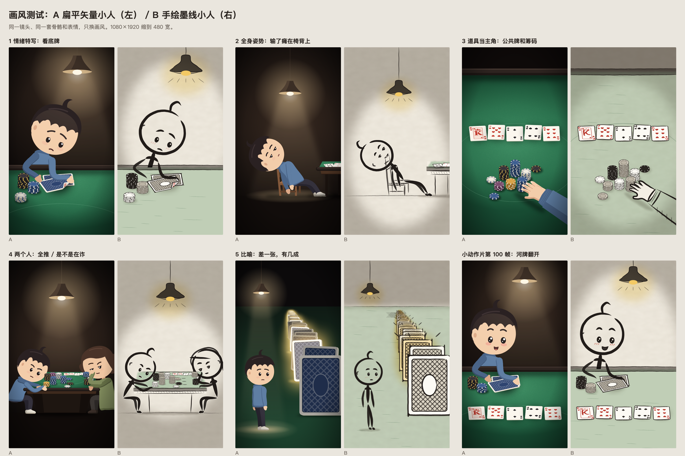
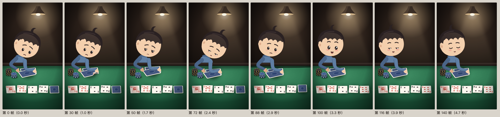
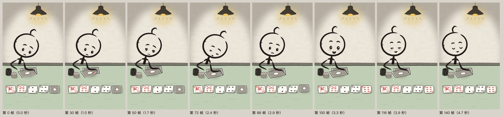

# 推荐用 A（扁平小人）：手机上表情和姿势都读得出；B 有手画的温度，但火柴棍身体撑不起姿势

两种画风共用同一套骨骼、表情和牌桌布局，只换画法。五个牌桌镜头、两段 5 秒小动作片都已出图，待你验收。

- **做到哪**：10 张静帧（A、B 各 5）、2 段 5 秒片（1080×1920，30 帧/秒）、对照总图、手机尺寸对照图，都在本目录。
- **结果**：缩到手机宽（390 点），A 的五个镜头表情都读得出；B 的特写读得出，全身镜头里脸偏小、肩背弱。
- **要你定**：往下做哪种画风。我推荐 A，理由在“要你定的事”。



---

## 先说短板

**A 的短板**
- 撞类型：观火、西西弗用的就是这类扁平小人。我给主角定了两个记号：灰蓝连帽衫、头顶一撮翘毛。够不够区分，没验证过。
- 骨骼是平面的，没有透视缩短：
  - 往观众这边伸手，是把手的目标点往画面下方挪来凑的；
  - 正面坐着时大腿用“缩短系数”硬压短（抱头那个姿势）。
- 手在全身镜头里是“连指手套”。拿牌只是手搭在牌上，没有手指扣住牌。
- 瘫坐仰头时整颗头转了 60 多度，五官跟着横过来，有点像“脸躺倒了”。
- 场景的光（灯光、绒布的亮圈）用了柔光渐变。人本身是平涂两层色，没描边、没渐变。

**B 的短板**
- 身体就是一根线。肩膀是我补的一笔，“叹气肩落下”在 B 里比 A 弱很多。
- 和 AI 生图的“火柴人人生感悟”是同一类外观。线会抖、是代码一笔笔画的，但静帧上看不太出这点区别。
- 牌放大以后墨线偏粗，牌背的交叉排线偏密。
- 暗处是一圈椭圆淡墨，做法比较简单。

**两种都没做的检查**
- 没请独立评委打分（按你的要求没开别的代理）。
- 5 秒片我只能看抽出来的 8 帧（见 `参考表/*_小动作片分解.png`），没法连着播放看节奏。

---

## A：扁平小人，夜里一盏灯



**已经好的**
- 表情最清楚。眉毛在演：看底牌时眉头往上拧；河牌翻开时眉毛抬起；松气时闭眼带笑。
- 道具像实物。牌有纸的厚度、软阴影、歪着放；掀起的牌角里能看到“9♥”。筹码有侧面和一段段边纹。
- 和《等待》的暗房间、一盏灯能接上。

**还差的**
- 见上面的短板。
- 两个人那个镜头里，桌子和人挤在画面中下部，上半屏是暗墙和灯。字幕放上面还是下面，要等真做片时再排。

## B：手绘墨线小人，纸色底



**已经好的**
- 有“人画的”感觉：线有粗细，两头收尖；每 3 帧轻轻抖一次，幅度约 1 像素。
- 留白多，画面干净。牌、筹码也是手画的线，和人是一套。
- 暗处压淡墨，灯下留纸白，光是“留”出来的。

**还差的**
- 身体太简单，全身姿势（瘫坐、全推）读起来比 A 费劲。
- 人和椅子的线容易缠在一起。现在每笔外面先垫一圈纸白，把后面的线挡开。

---

## 对照调研第二节第 5 条那张表

| | 《等待》的旧画法 | A | B |
|---|---|---|---|
| 轮廓 | 8 根胶囊叠起来 | ✓ 上身是一整块轮廓，跟着脊柱三段弯；四肢是锥形管，接上画过的手和鞋。<br>△ 侧身时，手臂起点的圆头还压在上身上 | ✓ 有粗细、两头收尖的线；头是手画的一圈，不闭合 |
| 脸 | 只有侧脸，没有眼眉 | ✓ 点眼带白高光、弯眉、嘴；9 种表情 | ✓ 同一套表情数字，画成两三笔；腮红是几道短排线 |
| 姿势 | 一直坐着 | ✓ 每个镜头一个新姿势：看底牌、瘫坐仰头、全推、托腮盯着、站着、叹气、松气 | ✓ 姿势相同。<br>△ 没有肩背，瘫坐和叹气弱 |
| 道具 | 圆角矩形加细亮边 | ✓ 牌：纸厚、软阴影、歪放、掀角、翻面。<br>✓ 筹码：侧面和边纹。<br>✓ 绒布有颗粒；包边是皮的，上沿一道受光。<br>△ 椅子还是几块平面拼的 | ✓ 手画线；阴影是一块淡墨；暗面是排线 |
| 颜色 | 暖光、冷光、红 | ✓ 每人一个主色加一层暗面；红色只出现在红桃、方块上 | ✓ 只用墨、淡绿桌布、红墨花色、灯下一点黄 |

红线也逐条查过：
- 画面里没有钱、钞票、货币符号，也没有任何 App 或俱乐部的标志。
- 筹码上不写面额。
- 52 张牌都画了一遍，在 `参考表/A_牌和筹码.png`、`参考表/B_牌和筹码.png`。红桃、方块是红色，黑桃、梅花是黑色。2–10 的花色点按标准牌排；A 是一个大花色；J、Q、K 画成边框加大字母和小王冠，不是真牌上的人像。

---

## 五个镜头画了什么（两种画风内容一样）

牌局前后对得上：
- 底牌 9♥ 8♥。
- 公共牌 K♥ 7♥ 2♣ 4♠，河牌 6♥，凑成同花。

| 镜头 | 画面 | 文件 |
|---|---|---|
| 1 情绪特写 | 牌桌边低头看底牌，近侧的手掀起牌角，露出 9♥。眉头微皱，吊灯在头顶 | `A1_看底牌.png` `B1_看底牌.png` |
| 2 全身姿势 | 输了一手，屁股滑到椅面前沿，背靠椅背，仰头看灯。桌角两张翻开的牌 | `A2_输了瘫坐.png` `B2_输了瘫坐.png` |
| 3 道具当主角 | 俯视绿色绒布：一排五张公共牌，一堆筹码，一只手从右下伸进来推筹码 | `A3_公共牌和筹码.png` `B3_公共牌和筹码.png` |
| 4 两个人 | 牌桌两头：左边的人两臂伸直把筹码全推出去；右边的人托着腮、眯眼、挑一边眉 | `A4_全推和怀疑.png` `B4_全推和怀疑.png` |
| 5 比喻 | 一个人站在一长排立着、扣着的牌前，这排牌一直排到远处。46 张里有 9 张发亮 | `A5_差一张.png` `B5_差一张.png` |

镜头 5 的数字按真实牌局算：
- 转牌后已知 6 张牌，没见过的还有 52 − 6 = 46 张；
- 其中红桃还剩 13 − 4 = 9 张；
- 9 ÷ 46 ≈ 19.6%，就是“差一张，不到两成”。

5 秒小动作片（`A_小动作片.mp4`、`B_小动作片.mp4`）：

| 时间 | 动作 |
|---|---|
| 0–1.1 秒 | 掀牌角看底牌，担心 |
| 1.1–2.7 秒 | 牌角放下，先吸一口气（肩微提），再叹气：肩落下、背驼、头低、眼皮垂下，嘴边飘出一口气 |
| 2.7–3.3 秒 | 抬眼看桌面，河牌翻开，是 6♥ |
| 3.3–3.6 秒 | 眉毛抬起，眼睛睁大 |
| 3.6–5 秒 | 闭眼、嘴角带笑、呼出一口气，肩松下来 |

全程都有呼吸起伏；睁眼的段落里会眨眼。

---

## 组件怎么用

代码在 `studio/src/components/people/`，测试合成在 `studio/src/videos/style_test/`。

**单位和坐标**
- 头高约 100 个单位，站直约 265，约 2.65 头身。
- `x, y` 是人脚下那一点在画面上的位置（像素）。
- `s` 是缩放：1 个单位等于 `s` 像素。
- 人默认脸朝右，`facing={-1}` 左右镜像。

**画一个人**

```tsx
import {FlatPerson} from '../../components/people/FlatPerson';   // 画风 A
import {InkPerson} from '../../components/people/InkPerson';     // 画风 B
import {pose} from '../../components/people/rig';
import {EXPR} from '../../components/people/face';
import {ME, OTHER} from '../../components/people/look';

<FlatPerson pose={pose('peek')} expr={EXPR.worry} look={ME} x={300} y={1640} s={4.6} />
<InkPerson pose={pose('peek')} expr={EXPR.worry} look={ME} x={300} y={1640} s={4.6} frame={frame} seed="p1" />
```

| 参数 | 两种都有 | 说明 |
|---|---|---|
| `pose` | ✓ | 姿势（下表的名字用 `pose('名字')` 取） |
| `expr` | ✓ | 表情（`EXPR.名字`，也可以自己给一组数字） |
| `look` | ✓ | 长相：`ME` 灰蓝连帽衫、短发翘毛；`OTHER` 橄榄绿外套、齐肩短发 |
| `x` `y` `s` `facing` | ✓ | 位置、大小、朝向 |
| `part` | ✓ | `'all'` 全画；`'body'` 不画胳膊；`'arms'` 只画胳膊。<br>人坐在桌后时：先画 body，再画桌子，最后画 arms |
| `light` | A | 光从哪边来，暗面在另一边 |
| `glow` | A | 一处小光源照在脸和手上（吊灯、手机屏） |
| `dim` | A | 离灯远时压暗 |
| `phone` | ✓ | 两手之间拿一部手机 |
| `frame` `seed` | B | 线条抖动按帧算，同一个 seed 每次渲染都一样 |
| `weight` | B | 线粗倍数（特写里用 0.7–0.8） |
| `halo` | B | 每笔外面垫一圈纸白（像素），挡开背后的线 |

**姿势名**（`rig.ts`，FK 骨骼：转肩带动整条手臂。手和脚也可以给目标点，用两节 IK 反算肘和膝）

| 名字 | 姿势 | 名字 | 姿势 |
|---|---|---|---|
| `sit` | 坐 | `peek` | 看底牌 |
| `slump` | 瘫坐仰头 | `peekSigh` | 看完叹气 |
| `phone` | 低头看手机 | `board` | 抬眼看桌面 |
| `sigh` | 看手机时叹气 | `allIn` | 全推 |
| `headInHands` | 抱头 | `think` | 托腮盯着 |
| `stand` | 站着等 | `standLook` | 站着低头 |
| `benchWait` | 长椅上等 | `walk` | 走，`pose('walk', 相位 0..1)` |

全部姿势见 `参考表/A_姿势表.png`、`参考表/B_姿势表.png`。

**表情名**（`face.ts`）
- `calm` 平静、`worry` 担心、`teary` 委屈含泪、`relief` 松一口气、`blank` 发呆、`surprise` 惊喜、`sighing` 叹气、`suspect` 怀疑、`sad` 难过。
- 每种表情是一组数字：眉高、眉头拧、眉弯、眼皮、眼大小、高光、泪、嘴宽、嘴角、张嘴、波浪嘴、圆嘴、腮红、两眉高低、嘴歪。两种表情之间可以直接插值。
- 全部表情见 `参考表/A_表情表.png`、`参考表/B_表情表.png`。

**动起来**

```tsx
const r = poseTrack(f, [[0, pose('peek')], [40, pose('peekSigh')]], easeInOut);   // 姿势关键帧
const e = exprTrack(f, [[0, 'worry'], [60, 'relief']], easeInOut);                 // 表情关键帧
const r2 = nudge(r, {shrug: 0.06 * breath(f)});                                     // 叠呼吸、耸肩之类的小动作
const e2 = withBlink(e, blink(f, 'seed'));                                          // 眨眼：每 2–5 秒，按帧确定性随机
```

**道具**

| 文件 | 内容 |
|---|---|
| `cards.ts` | `card('9h')` 取一张牌；四种花色的形状；2–10 花色点的位置；掀角的几何 |
| `FlatCards.tsx` | A 的牌和筹码：<br>`TableCard`：桌上的牌，可扣着、掀角 `peek`、翻面 `flip`；<br>`StandingCard`：立起来的牌，可发亮 `glow`；<br>`ChipStack` / `LooseChip`：一摞或一枚筹码，颜色 `CHIP.navy/cream/black/amber/plum`；<br>`Felt`：绒布；`Rail`：皮包边 |
| `FlatProps.tsx` | `SoftShadow` 软阴影、`PendantLamp` 吊灯、`Chair` 木椅、`ReachHand` 伸过来的手 |
| `InkCards.tsx` | B 的同一套：`InkTableCard`、`InkStandingCard`、`InkChipStack`（`tone` 0 白、1 灰、2 黑）、`InkFelt`、`InkRail` |
| `InkProps.tsx` | `Paper` 纸、`Wash` 淡墨、`InkShadow`、`Hatch` 排线、`InkLamp`、`InkChair`、`InkReachHand` |
| `ink.ts` | `ink()`：一串点画成一笔墨线（带抖动）；`inkCircle()`：手画的圈 |

**出图命令**（先 `export PATH=/Users/decheng.huang/Documents/dy/tools/node/bin:$PATH`，再 `cd studio`）
- 镜头静帧：`npx remotion still src/index.ts StyleA1 out.png --frame=20`（A1–A5、B1–B5）
- 小动作片：`npx remotion render src/index.ts StyleAMini out.mp4`（B 是 `StyleBMini`）
- 对照图：`StyleCompare`、`StyleComparePhone`
- 参考表：`StylePosesA/B`、`StyleFacesA/B`、`StyleCardsA/B`、`StyleMiniStripA/B`

---

## 要你定的事：往下做哪种画风

**现状**：两种都能用同一套组件出片，换画风只换渲染那一层，骨骼、表情、牌局、时间点不用重做。

**选项**
- **A 扁平小人**：暗房间、一盏灯，人有颜色有暗面，牌和筹码画成实物。
- **B 墨线小人**：纸色底，人是带粗细的线，线一直轻轻抖。

**推荐：A。理由：**
1. 在手机上读得出。缩到 390 点宽，A 五个镜头的表情都看得清。B 在全身镜头里只剩一个圈加几根线。
2. 姿势撑得住。牌桌题材里，看牌、全推、瘫坐、托腮这些动作都靠肩背和手臂的体积，B 的火柴棍身体表达不出来。
3. 离“精致是底线”更近。三位评委压分是因为“几何形状拼的”和“像 App 组件”。A 的人有设计过的轮廓，牌和筹码有材质；B 的道具有手作感，但人仍是最简单的火柴人。

选 A 以后先补这几件：
1. 给主角加一个更醒目的固定记号，和观火、西西弗那类小人拉开；
2. 拿牌的手画出手指；
3. 侧身时手臂起点和上身的接缝改成一整块；
4. 瘫坐仰头那种大角度，头部单独画一个仰起来的脸。

---

## 还没解决的问题

- **透视**：骨骼是平面的。人往观众这边伸手、正面坐着，都是靠挪目标点、压短大腿凑出来的。要更自然，得给骨骼加一层透视缩短。
- **动作只有“姿势到姿势”的插值**：没有惯性、跟随、预备动作。叹气和松气靠表情和肩的上下撑着，身体其余部分动得少。
- **人像牌**：J、Q、K 是边框加大字母，不是真牌的人像。近景特写里出现人头牌时，可能显得简单。
- **比喻镜头数不清**：远处的牌挤在一起，看不出是 46 张。要让观众数，得换成平铺的牌阵。
- **掀角的点数方向**：只在现在这个摆放角度（牌转 −112°）核对过读得正。换别的角度要再看一眼。
- **画风 B 渲染更重**：淡墨用了模糊和位移滤镜。5 秒片 A 是 1.0 MB，B 是 2.3 MB，渲染也更慢。

## 本目录的文件

- 静帧：`A1_看底牌.png` … `A5_差一张.png`，`B1_看底牌.png` … `B5_差一张.png`
- 小动作片：`A_小动作片.mp4`、`B_小动作片.mp4`
- 对照：`对照总图.png`（同一镜头 A 左 B 右）、`手机尺寸对照.png`（每格 390 点宽，在电脑上按 100% 看，接近手机实际大小）
- 参考表：`参考表/` 下是姿势表、表情表、牌和筹码、小动作片分解（各 A、B 一张）
